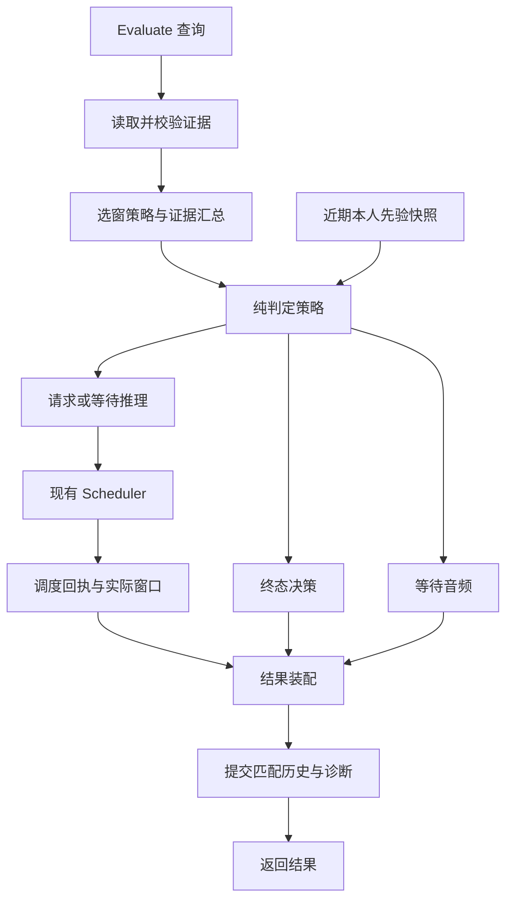

# SpeechGatedSpeakerVerifier.EvaluateCore 重构实施规范

日期：2026-11-09。调研代码基线：`1545523`。状态：待实现。本文件可独立交给其他 AI 或开发者执行，无需读取原始聊天。

本次采用 **Strategy（选窗算法）+ 固定阶段编排 + Functional Core / Imperative Shell（纯判定与副作用分离）**。直接替换当前实现，删除旧分支和辅助方法，不设置新旧算法开关、兼容适配层或失败后回调旧实现的路径。

用户要求：使用合理的设计模式，允许不保留任何回退的完全重构。此授权覆盖必要的内部类型、方法和调用方调整，不要求保留旧实现结构。

“不保留回退”指不保留旧实现。高置信、强上游证据、近期本人先验、Prefix 等是本次要求保留的业务规则。除第 6 节明确的修正外，保持授权条件、阈值与投票优先级；不删除这些业务能力，也不借重构调整模型、声纹注册、profile 格式或算法阈值。

本文件中的行为契约、依赖边界及验收标准是实施要求；新类型名称和内部方法签名可按代码库习惯调整。遇到基线之外的新代码，先检查差异并保留他人修改，不依靠本文记录的旧行号直接覆盖文件。任何无法满足的要求都应在交付说明中列出原因，不得以静默降级代替。

## 0. 实施入口与范围

- 目标项目：`src/VoiceBox.Assistant/VoiceBox.Assistant.csproj`。
- 主要入口：`Modules/Speaker/Controllers/SpeechGatedSpeakerVerifier.cs` 的 `EvaluateCore` 及其私有辅助方法。
- 测试项目：`src/Tests/VoiceBox.Assistant.Tests/VoiceBox.Assistant.Tests.csproj`，目标框架 `net10.0`。
- 必须先阅读：本文件、`docs/voicebox-assistant-architecture.md` 的目录职责/并发/设计模式约定，以及仓库中适用的 `AGENTS.md`。
- 允许调整：Speaker 内部 evidence、policy、state、model、scheduler；相关 Wakeup/VAD/BargeIn 调用方；对应测试与架构文档。
- 本次不扩展：新的公开配置项、新的模型/provider、新的通用规则框架、候选生命周期状态机或全局消息总线。
- 最终交付代码只保留一条验证路径。修改可分步骤进行，但不能把仅提取几个私有方法或新增未接入组件作为完成结果。

下文代码路径均相对仓库根目录；源文件行号只对应上述调研基线。

## 1. 当前结构与问题

`SpeechGatedSpeakerVerifier.cs` 共 796 行，`EvaluateCore` 位于 174–455 行，共 282 行，包含 31 个 `if`。这些数字只说明阅读成本；真正的拆分依据是职责及其变化原因。

| 当前位置 | 职责 | 重构动机 |
|---|---|---|
| 176–225 | 配置、运行状态、bank、候选区间、timeline 校验及有效语音统计 | 运行事实读取与规则判断混在一起 |
| 205–207、245–254、510–635 | 初步几何选择、Wakeup 按语音覆盖排名、Recent 跳过已知静音 | 选窗逻辑分散在 selector 和 verifier；初步元数据与实际窗口列表可能脱节 |
| 256–318 | 缓存读取、计数、分数汇总、待推理窗口发现 | 大量局部变量共同承载一个未命名的领域概念 |
| 320–359 | 多条通过路径、提前拒绝 | 规则顺序有业务含义，需要独立测试 |
| 362–431 | 调度、实际 pending 窗口查询、过载处理、继续等待 | 推理任务状态直接影响调用方期限，不能作为普通实现细节隐藏 |
| 434–454 | 最终拒绝或证据不足 | 与用途、输入结束、音频到齐共同相关 |
| 638–786 | Prefix、Match、Final、近期本人先验 | 隐式调度、历史写入、日志、结果装配混合；`Match` 有 16 个参数 |

已有 `SpeakerAudioTimelineBuffer`、`SpeakerEvidenceCache`、`SpeakerInferenceScheduler`、`SpeakerProfileMatcher` 等职责明确的组件。重构可以继续使用这些组件；它们不是旧算法回退路径。

需要特别澄清的数据含义：

- `latestWindowMatched` 实际表示“最新一个已成功取得当前 bank 分数的窗口”，并不保证是最新选中窗口；后续窗口缺失、失败或静音时不会清除该值。
- `bestWindow` 是最高分窗口，触发快速通过的窗口可能是另一个窗口。诊断分数与决策依据应分开表达。
- `invalid` 同时计入缺失窗口、静音和部分失败，不能当作互斥分类统计。
- `InputComplete` 与身份音频到齐是两个事实；只有同时成立才是 `candidateExhausted`。

## 2. 设计模式比较

| 方案 | 适用性 | 结论 |
|---|---|---|
| 仅提取私有方法 | 可缩短方法，但调度、状态和规则仍共享依赖 | 不足以完成此次职责重构 |
| Strategy | Wakeup 与 Recent 存在真实的选窗算法差异 | 采用，接口限定为选窗职责 |
| 固定阶段 Pipeline | 校验、读取、归纳、判定、执行具有稳定顺序 | 采用显式调用，不引入通用管线框架 |
| Functional Core / Imperative Shell | 证据判定可以只接受值并返回决策；调度和日志需要执行副作用 | 作为主要架构边界 |
| 全流程责任链 | 前半段需要累积证据；后半段规则有严格顺序，调度还需返回实际状态 | 不作为主结构，避免共享可变 context 和隐式 next 调用 |
| Template Method | 三种用途共享大部分流程，用继承容易产生大量覆写钩子 | 不采用 |
| 每个候选一个 State 对象体系 | 候选生命周期已由调用方管理，verifier 每次查询读取当前证据 | 此次不增加第二套生命周期状态机 |

现有架构文档第 11 节也要求组合优先，禁止每类一个接口、万能 Context 和通用 Kernel。本方案沿用该边界，所有新类型留在 Speaker 模块内。

## 3. 目标职责划分

| 组件 | 目标位置 | 职责 |
|---|---|---|
| `SpeechGatedSpeakerVerifier` | `Controllers/` | 生命周期、采集入口、等待通知以及一次查询的短编排 |
| `SpeakerEvidenceReader` | `Evidence/` | 读取并校验运行事实，调用选窗策略，读取窗口证据，形成此次查询的证据汇总 |
| `ISpeakerWindowSelectionStrategy` | `Contracts/` | 从候选窗口描述中选择实际窗口，不提交推理 |
| `WakeupSpeechWindowSelectionStrategy` | `Evidence/` | 按语音覆盖率排名，以 focus 距离打破平局，最终按时间排序 |
| `RecentSpeechWindowSelectionStrategy` | `Evidence/` | 选择最近的完整窗口，跳过已知 Ineligible，保留待推理窗口 |
| `SpeakerDecisionPolicy` | `Policies/` | 根据查询事实、证据、用途规则和先验快照，返回决策或下一步需求 |
| `RecentOwnerMatchState` | `State/` | 读取和更新最近本人证据，集中管理生命周期与并发语义 |
| `SpeakerInferenceScheduler` | `Evidence/`，现有 | 唯一推理执行者；返回此次调度状态及实际占用窗口 |

只有选窗算法具有两个实际实现，值得引入策略接口。Reader、DecisionPolicy、PriorState 使用具体的 `internal sealed` 类型即可。

`SpeakerEvidenceWindowSelector` 中通用的 hop 对齐、完整窗口枚举可保留并收敛为几何工具。旧 Wakeup/Recent 方法若被新策略完全取代则删除。Prefetch 继续共享同一套几何，不复制窗口计算公式。

用途差异由构建时的用途配置集中表达；数值阈值仍由 `SpeakerPurposePolicy` 提供。仅用一个封闭枚举表达结束方式，避免把散落的 purpose 判断换成更多相互依赖的布尔开关。



判定阶段没有 Logger、Scheduler、SpeakerService 或可变缓存引用。调度失败的结果映射也由一个小的纯函数完成。整个 `Evaluate` 仍同步返回，不等待模型执行。

选窗策略只消费窗口描述和只读值，不自行访问 Scheduler、调用模型或写入缓存。Reader 负责取得语音覆盖率、已知静音等运行事实；策略负责筛选与排序。不要通过委托把这些副作用重新藏进策略。

用途与选窗策略在构造时完成绑定。`SpeakerPurposePolicy` 继续提供经过校验的阈值参数；用途的结束方式可使用模块内部枚举表示。不要创建三份几乎相同的完整 Evaluate 实现。

## 4. 数据模型与执行协议

形成以下三个明确的领域模型，避免继续向方法传递十几个散落的计数和样本位置：

1. `SpeakerCandidateProgress`：输入是否结束、音频是否到齐、候选有效语音量、实际选窗覆盖情况、下一证据需求。
2. `SpeakerEvidenceSummary`：匹配/拒绝/模糊的已评分证据、缺失/静音/失败的独立计数、最新已评分窗口、最佳分数、实际支持决策的证据范围、单独的 Prefix 观察。
3. `SpeakerEvaluationDecision`：终态、等待音频或需要推理中的一种，并带有明确原因和证据。通过受约束的构造入口避免“已终态但仍需新推理”等矛盾组合。

这些模型表达业务事实，不携带服务对象。可以采用小型只读值类型，较大的窗口集合以只读视图传递，不复制 PCM 或 embedding。

一次查询的步骤：

1. 校验启用状态、bank、区间和 timeline，并读取先验。
2. 读取候选窗口描述，按策略选择窗口，构造一次判定所需的汇总；Prefix 也作为显式证据读取。
3. 优先检查已经足以通过或拒绝的缓存证据。已终态时不提交新推理。
4. 若还需要推理，明确选择一个任务：已有候选任务优先继续；否则按第 4.1 节选择 Prefix 或普通窗口。
5. 提交这一项调度需求，根据回执映射 `Queued / AlreadyKnown / CandidateBusy / Overloaded / Stopped`。一次查询最多新增一个候选推理任务。
6. 装配结果；匹配时以实际支持证据更新先验；统一记录诊断。

将 Scheduler 的候选调度结果升级为包含“状态 + 实际 pending 窗口”的回执，避免调用方把请求窗口当成执行窗口。若 `AlreadyKnown` 时窗口已在读取后完成，应重新读取该窗口并有限次重新判定；若仍在执行则返回实际窗口。不能把这两种情况当成同一种新任务。具体回执可沿用现有枚举加值对象；禁止无限重试或同步等待 worker。

读取操作不天然构成 timeline、cache 和 scheduler 的全局原子快照。实现时沿用短锁，明确 epoch/连续段的有效性检查；出现读取失效时返回已有 timeline 失败语义。不得为实现“快照”新增包住全流程的大锁，也不得在锁内调用 provider、日志或等待。

### 4.1 普通窗口与 Prefix 的统一调度

按以下顺序处理，Prefix 作为同一套验证流程中的可选证据类型：

1. 所有已缓存的决定性证据优先，包括已缓存的 Prefix；存在终态结果时不提交新任务。
2. 尚未终态且候选已有在途任务时，继续等待该任务；窗口选择变化不替换它，也不刷新其身份。
3. 无在途任务、Prefix 已启用、用途允许、无拒绝票、Prefix 区间完整可用且缓存缺失时，优先申请 Prefix。这保留当前代码先尝试 Prefix 再申请普通窗的顺序。
4. Prefix 不适用、尚未有完整音频、或已有非高置信结果时，选择时间顺序最早的缺失普通窗口。
5. Prefix 的普通低分、模糊、Ineligible 或推理失败不得直接形成身份 Mismatch，也不得计入普通窗口投票；继续按照普通证据及候选结束条件判定。候选已结束、没有任何标准窗且唯一可用证据是失败的 Prefix 时，返回 Unavailable 并保留失败原因；Prefix 只是低分或不合格时返回相应的证据不足。
6. 短候选没有标准窗但存在可执行的 Prefix 时，提交后保持 Pending，直到完成、取消、错误或调用方期限耗尽；不得因标准窗数量为零提前结束。

### 4.2 调度回执与等待协议

| 情况 | 必须行为 |
|---|---|
| Queued | 返回 WaitingForInference，携带实际任务区间 |
| AlreadyKnown，窗口仍在途 | 复用原任务，返回它的区间，不新增 embedding 提取 |
| AlreadyKnown，证据已经发布 | 有界重读并重新判定，不把已完成窗口当作新等待对象 |
| CandidateBusy | 返回占用该候选的实际窗口，不能返回本次想申请的窗口 |
| Overloaded | 依第 5 节映射；未实际提交时不得伪造 PendingWindow 区间 |
| Stopped | 返回 Unavailable / RuntimeStopping |
| PrefetchRejected | 只供预取路径消费，不作为正常候选调度的业务结果 |

开放 SingleTalk 在零已评分证据且过载时仍返回 Pending / WaitingForInference，但没有实际任务时 pending 区间为空。这是等待资源的业务状态，不能伪装成已在执行的任务。调用方仍按现有规则对开放 SingleTalk 暂缓应用推理期限。

`WaitForDecisionAsync` 必须保留“先取得更新信号，再 Evaluate，再等待”的次序，避免丢失期间发布的证据。等待音频与等待推理使用明确的 Reason；音频到达和证据发布继续触发更新信号，取消等待 token 时及时结束等待。`Cancel(candidateId)` 继续取消候选排队任务并保留可复用缓存；不新增永久候选取消表。不得添加轮询 Sleep 代替现有通知机制。

### 4.3 结果与诊断契约

- 保留 `ISpeakerEvidenceProvider` 的非阻塞查询、异步等待、取消和期限查询职责。内部 DTO 可以调整，所有消费者在同一重构中更新，不保留旧 DTO 的双轨适配。
- 结果保留用途调用方所需的 Status、Reason、CandidateId、epoch、投票统计、分数分量、证据范围、RequiredEvidenceEnd 及实际 PendingWindow 信息。
- 已评分普通窗口内部划分为 Match/Rejected/Ambiguous，其他窗口划分为 Missing/Ineligible/Failed，分类互斥。保留 `InvalidWindows` 字段时仅作为诊断投影，禁止判定规则依赖其旧混合含义；本次将其定义为 Ineligible 与 Failed 的合计，Missing 单独表达，并更新受影响测试/日志。
- 标准窗的 `Score` 及 centroid/best/top2 分量继续报告已评分标准窗中的最佳分数，四个值来自同一窗口。PrefixMatch 报告 Prefix 的分数。实际支持判定的窗口及其范围另行保存在决策数据中，不用最高分窗口冒充支持证据。
- PrefixMatch 的 evidence 起止位置与先验结束位置必须取实际 Prefix 区间。普通匹配的先验结束位置继续取最新匹配标准窗的结束位置。
- 每次 Evaluate 的最终返回结果只记录一次 query/result/decision；内部重读或重判定不得重复计数，也不得重复写入匹配历史。超时转换保留已有部分证据。
- 不改变全局日志级别。恢复基线测试需要的推理完成结构化 Debug 日志，保留 `EmbeddingMs`、`QueueWaitMs`、`JobMs`、`TotalMs`、`CandidateId`、`Start`、`Kind` 等字段。

## 5. 必须保留的用途语义

| 行为 | Wakeup | BargeInCommand | SingleTalk |
|---|---|---|---|
| 模板 bank | CleanNearEnd | DoubleTalkNearEnd | CleanNearEnd |
| 选窗 | 整个候选按语音覆盖排名 | 最近非已知静音窗口 | 与 BargeIn 共用 Recent 策略 |
| 当前高置信/融合证据可提前通过 | 是 | 是 | 是 |
| 开放候选达到负票阈值可提前拒绝 | 是 | 是 | 否 |
| 足量窗口仍不明确且输入开放 | 当前实现可结束为证据不足 | 继续滑动等待 | 继续滑动等待 |
| Prefix 高置信 | 配置开启时使用 | 配置开启时使用 | 不使用 |
| 调度过载且没有已评分窗口 | Unavailable | Unavailable | 输入开放时 Pending；InputComplete 后 Unavailable |

这里的“最终拒绝需音频到齐”特指 SingleTalk 的证据拒绝；它不等于所有错误均等待音频。当前过载分支按 `InputComplete` 判断，不能无意改成按 `candidateExhausted` 判断。

判定优先级必须按以下顺序实现，并变成可测试的决策表：

1. 基础不可用或区间失败。
2. 最新已评分窗口高置信、无拒绝证据，且有效语音足够或存在 focus。
3. 最新已评分窗口普通匹配、无拒绝证据，且强上游或近期本人先验成立；同样要求有效语音足够或存在 focus。两者同时成立时优先报告强上游。
4. 普通匹配票数达到 `RequiredMatches`，且有效语音足够；当前允许同时存在拒绝票。
5. 配置允许的 Prefix 高置信，无拒绝证据。
6. 用途允许的提前多数拒绝：拒绝票达到阈值，且没有匹配票。
7. 推理需求及调度反馈。
8. 用途对应的继续采集/等待证据。
9. 终结：全无可评分证据且存在失败则 Unavailable；否则负票多于正票且有负票则 Mismatch；剩余情况为 InsufficientEvidence。

规则的优先级先用明确方法调用和小型决策表实现。当前没有动态插拔规则的需求，无需为每条规则创建 handler/interface。

无推理需求后的 Pending 原因也须保持明确：实际已选窗口不足且候选未耗尽时，语音足够返回 WaitingForEvidence，否则 CollectingCandidate；窗口足够但语音不足且候选未耗尽时返回 CollectingCandidate；BargeIn/SingleTalk 在候选未耗尽且没有其他决定性证据时返回 WaitingForEvidence。

选窗细节不改变：普通窗口以连续段起点对齐 hop，完整落在候选及已保留音频内；Wakeup 优先语音比例，再按窗口结束位置到 focus 中心的距离排名，无 focus 时距离参考点取候选起点，同等条件保持稳定顺序；最终窗口按时间升序。Recent 只跳过缓存中已经确认 Ineligible 的窗口，不能把未知窗口当成静音。

## 6. 应在新实现中解决的边界

以下风险来自静态分析，除基线日志问题外尚未通过新增复现测试验证。实现者须先补行为测试，再完成对应修正；这些修正属于本次范围，不需保留有问题的旧行为。

- **Prefix 隐式调度与等待不一致。** `TryPrefixHighConfidence` 在缓存缺失时直接提交任务，却忽略调度返回值，也不增加普通窗口的 `pendingInference`。完整候选短于标准窗、但长于 Prefix 时，可能在 Prefix 已提交后直接返回 InsufficientEvidence。新设计应显式表达 Prefix 缺失、执行中、完成和失败。
- **Prefix 结果范围。** Prefix 匹配当前复用普通窗口的 `selection/evidenceEnd/latestMatchedEnd`，可能没有反映真实 Prefix 区间，影响诊断及先验。新结果和先验应引用实际支持证据。
- **选窗元数据来源。** 当前先计算几何，再局部覆盖 `FirstWindowStart/WindowCount`，但保留原 `RequiredEvidenceEnd`。新窗口计划统一产出“实际已选窗口”和“继续等待的目标”，后者会影响 Wakeup 的计时，必须配套调用方测试。
- **最新窗口定义。** 保留“最新已评分窗口”的规则，并增加“后续窗口仍缺失或失败”的用例。本次不改成要求最新选中窗口已评分。
- **近期本人先验状态。** Start/Stop 清空先验；epoch 切换使旧先验失效；同 epoch 下仅向较新的匹配证据结束位置推进。并发更新使用当前运行代际与 epoch 校验，迟到的旧查询不得在 Stop/重启/epoch 切换后恢复旧先验。先验仍只在当前查询参考起点严格晚于上一匹配证据末尾、且距离不超过配置范围时成立，不单独授权。
- **计数分类。** 缺失、静音和失败独立统计，结果按第 4.3 节明确投影。

`RequiredEvidenceEnd` 属于 Wakeup 计时协议，不能直接设为“当前最后一个选中窗口的结束位置”。新选窗计划区分实际已选窗口与目标几何，本次保留现有 selector 的目标公式。记 `W = WindowSamples`、`H = HopSamples`、`N = policy.WindowCount`、`C = W + (N - 1) * H`：

- Recent：`desiredStart = CandidateStartSample`。
- Wakeup 有 focus：`desiredStart = max(CandidateStartSample, focusCenter - C / 2)`；没有 focus 时取候选起点。
- 两者均为 `RequiredEvidenceEnd = AlignUp(desiredStart, segmentStart, H) + C`，整数除法与 checked 运算语义沿用现有实现。
- 实际已选数量来自策略结果，零窗口不能保留旧的非零计数。上述目标位置不随着实际窗口排名被局部覆盖。

为这两个不同概念分别命名并增加 Wakeup 计时回归测试。本次不重定义 RequiredEvidenceEnd 的业务含义。

## 7. 直接替换范围与步骤

替换范围以 Speaker 模块内的选窗、证据读取、判定和先验状态为主。Scheduler 只做支持显式调度回执所必需的修改，继续作为唯一 worker。`SpeakerModule`、Wakeup、VAD、BargeIn 同步适配任何必要的内部结果契约调整，不添加兼容包装。

实现步骤可以分提交，但最终产品只保留一套执行路径：

1. 将上述决策表与用途差异写成行为用例，并先处理已知的基线日志测试失败。
2. 引入领域模型、两种选窗策略和纯判定组件，分别测试选择结果和授权结果。
3. 将 Prefix 与普通窗口统一纳入调度需求，集中处理实际 pending 窗口、过载与停止。
4. 一次性替换 `EvaluateCore`，删除旧选窗/Prefix/Match/Final 辅助方法，将先验移入状态所有者。
5. 更新架构测试：验证状态、worker、策略的所有权与依赖方向，去掉要求 verifier 必须直接持有所有旧协作者的断言。
6. 跑相关集成测试与 Assistant 全量测试；检查延迟、分配、调度次数，确认不会为了拆分类引入每帧对象链或重复推理。

`ISpeakerEvidenceProvider` 当前已表达非阻塞查询、等待与取消，具有继续使用的价值。内部实现完全重写不要求对这个入口做无收益的破坏；需要演进结果结构时同步更新全部调用方即可。

清理时逐项检查：

- 旧 `EvaluateCore` 中的投票、选窗、调度和结果装配分支已被新组件真正接管。
- 删除被替代的 `SelectWakeupWindowEndsBySpeech`、`SelectRecentSpeechWindowEnds`、`TryPrefixHighConfidence`、`Match`、`Final` 及相关局部状态；必要行为迁入对应所有者。
- 移除 verifier 中迁移到 `RecentOwnerMatchState` 的锁与字段；删除因重构失去用途的依赖、辅助类型和注释代码。
- 若修改 `TrySchedule` 签名，同步更新 `SpeakerSpeechPrefetchGate` 和所有调度调用方；保留预取限流、优先级提升、去重和取消语义。
- 不删除基于行为的回归测试来适配新实现；仅替换绑定旧私有字段结构的架构断言，并验证新的真实依赖边界。
- 没有 Legacy/V2、回退捕获分支、影子执行路径、弃用但仍可达的方法或未接入的新组件。

## 8. 测试与验收

纯判定测试使用固定证据值，无真实模型、无 worker、无 `Task.Delay`。至少覆盖：

- 高置信、强上游、近期先验、普通多数、Prefix 的优先级及反例。
- 先验/上游信号不能绕过当前声纹匹配，拒绝票对不同通过路径的影响。
- 三种用途 × 输入开放/完成 × 身份音频未到齐/到齐。
- 缺失、静音、模糊、provider 失败、bank 缺失的不同结果。
- 实际支持窗口范围、最新已评分窗口与最高分窗口不同的情况。

选窗测试覆盖宽 KWS focus、语音覆盖排名、平局、时间排序、尾部静音、零窗口、候选边界、gap/epoch 与 hop 对齐。

集成测试覆盖：

- 已缓存的决定性证据不新增推理；每个候选最多一个在途任务；同一窗口重复查询与预取复用不重复提取 embedding。
- Prefix 短候选等待、Prefix 任务被占用/过载/停止、Prefix 命中后的真实证据范围。
- 滑动选窗不能刷新已有任务期限；完成一个窗口后下一任务获得自己的预算。
- 用确定性占用 worker 和候选队列的方式触发真正的 Overloaded。现有开放 SingleTalk 过载测试断言 `OverloadCount == 0`，不足以单独证明 Overloaded 分支。
- 单讲低分前缀后恢复、endpoint 先于 identity 音频、取消保留可复用证据、重启后先验失效。

验收不以方法行数作为唯一目标：纯判定不依赖运行设施；用途差异集中；所有推理申请都经过显式协议；Pending 的原因与实际任务一致；无旧实现回退；现有业务契约和新增边界用例均通过。

建议新增的测试文件分别覆盖 DecisionPolicy、WindowSelection、Prefix 与 PriorState；文件数量可按职责调整。模型/worker 交错测试使用 TaskCompletionSource 等同步点，避免依靠真实毫秒时间猜测任务进度。

性能验收至少说明：Evaluate 不执行模型、不等待 worker；正常缓存命中路径没有新增 Task；选窗保留有界缓存/Span 等适合热路径的实现；没有复制音频或 embedding；同窗口共享和每候选单任务约束有断言。若声称性能提升，必须给出测量；仅有结构优化时不要声称提速。

## 9. 调研基线验证记录

以下结果是 2026-11-09 调研阶段在 `1545523` 上取得的历史基线，不代表重构完成后的验证。本文件整理时未重跑测试，也未修改实现或测试。

当时运行相关用例合计 38 个：37 通过，1 失败；失败用例单独复跑仍失败。没有运行整个解决方案测试。

- 第一组：verifier、Wakeup/Speaker 模块契约以及 verifier 所有权测试，共 32 个，31 通过、1 失败。
- 第二组：`ActiveNearEndTrigger_EachRequiredSpeakerWindowGetsItsOwnInferenceBudget` 与 `ActiveNearEndTrigger_SlidingSelectionDoesNotExtendABlockedSpeakerJob`，共 6 个，全部通过。
- 失败项：`InferenceTimeout_PreservesPartialEvidenceAndReportsWorkerTimings`。在测试第 422 行等待含 `EmbeddingMs` 的日志时超时。对应 `SpeakerInferenceScheduler.cs` 第 350–358 行推理完成日志被注释；前面的结果与超时字段断言已经执行通过。本轮未修改该问题。

主要依据：

- `src/VoiceBox.Assistant/Modules/Speaker/Controllers/SpeechGatedSpeakerVerifier.cs`
- `src/VoiceBox.Assistant/Modules/Speaker/Evidence/SpeakerEvidenceWindowSelector.cs`
- `src/VoiceBox.Assistant/Modules/Speaker/Evidence/SpeakerInferenceScheduler.cs`
- `src/VoiceBox.Assistant/Modules/Wakeup/Models/WakeupSpeakerAuthorization.cs`
- `src/VoiceBox.Assistant/Modules/Speaker/Controllers/VadSpeakerGateCoordinator.cs`
- `src/VoiceBox.Assistant/Modules/BargeIn/State/NearEndCandidateStateMachine.cs`
- `src/Tests/VoiceBox.Assistant.Tests/Speaker/SpeechGatedSpeakerVerifierTests.cs`
- `src/Tests/VoiceBox.Assistant.Tests/Runtime/VoiceAssistantBargeInInferenceDeadlineTests.cs`
- `docs/voicebox-assistant-architecture.md`

## 10. 验证命令

在仓库根目录的 PowerShell 中运行。先确认 .NET 10 SDK 可用；需要时执行 restore。基线测试应在实现前运行一次，记录当前代码相对本文件基线的差异。

```powershell
dotnet --version
dotnet restore src/Tests/VoiceBox.Assistant.Tests/VoiceBox.Assistant.Tests.csproj

# Verifier、模块契约及所有权测试。
dotnet test src/Tests/VoiceBox.Assistant.Tests/VoiceBox.Assistant.Tests.csproj --no-restore --filter 'FullyQualifiedName~SpeechGatedSpeakerVerifierTests|FullyQualifiedName~WakeupSpeakerModuleContractTests|FullyQualifiedName~ArchitectureOwnershipContractTests.SpeakerVerifier' --logger 'console;verbosity=normal'

# BargeIn 期限测试：按方法名过滤，文件名并不是测试类名。
dotnet test src/Tests/VoiceBox.Assistant.Tests/VoiceBox.Assistant.Tests.csproj --no-restore --filter 'FullyQualifiedName~ActiveNearEndTrigger_EachRequiredSpeakerWindowGetsItsOwnInferenceBudget|FullyQualifiedName~ActiveNearEndTrigger_SlidingSelectionDoesNotExtendABlockedSpeakerJob' --logger 'console;verbosity=normal'

# 实现后的最终验证，包含新增测试以及 Wakeup、VAD 等调用方回归。
dotnet test src/Tests/VoiceBox.Assistant.Tests/VoiceBox.Assistant.Tests.csproj --no-restore --logger 'console;verbosity=normal'

git diff --check
git status --short
```

新增组件测试在迭代时单独运行，最终纳入上述全量 Assistant 测试。若环境或已有无关失败阻塞全量测试，应记录失败命令、原因和影响范围，不得把未运行的项目写成通过。不要为了通过测试降低断言、放宽身份授权规则或加入旧实现回退。

## 11. 交付与完成标准

交付代码、必要的测试以及同步更新的架构说明，并在最终说明中提供：

1. 新组件的职责与实际依赖关系，说明旧逻辑已经移除的位置。
2. 已保留的业务行为和本次修正的行为，尤其是 Prefix、实际 pending 窗口、InvalidWindows 与先验生命周期。
3. 实际执行的测试命令和结果，说明基线日志失败的修复情况及任何未解决失败。
4. 未完成项或与本文偏离的实现选择及理由；全部完成时明确说明没有旧实现回退。

完成检查表：

- [ ] EvaluateCore 已成为短编排，选窗、证据汇总、纯判定、调度及先验各有明确所有者。
- [ ] 两种选窗策略已在生产路径使用，共用几何计算，没有三份用途流程复制。
- [ ] 纯判定可通过固定证据直接测试，不依赖模型、缓存、日志或线程调度。
- [ ] 第 5 节的用途语义、规则顺序和 Pending 原因已覆盖。
- [ ] Prefix 隐式调度与证据范围问题、先验失效和乱序写入问题已解决。
- [ ] 实际 pending 窗口、单任务、去重、取消与期限契约已验证。
- [ ] 调用方、预取和架构测试已同步调整，旧路径与无效代码已删除。
- [ ] 调研基线日志失败已修复；新增及现有相关测试通过，全量结果如实记录。
- [ ] 未增加旧实现回退、公开行为开关或无需求的通用框架。

## 12. 可直接发送给实现 AI 的任务说明

> 请阅读并执行 `docs/speaker-verifier-evaluate-core-refactoring.md`，完成 VoiceBox.Assistant 中 SpeechGatedSpeakerVerifier.EvaluateCore 的整体重构。采用文档确定的选窗策略、固定阶段编排和纯判定/副作用分离结构，允许改动必要的内部模型、Scheduler 和调用方，最终删除旧实现，不保留兼容层、新旧开关或回退路径。保留文档列明的授权规则，修复 Prefix 等明确列出的边界问题。先确认当前仓库状态、适用的 AGENTS.md 和测试基线，再完成实现、测试与清理；不要只提交方案或提取私有方法。按文档执行相关及 Assistant 全量测试，在最终报告中说明实际变更、行为修正、测试结果和任何未完成项。保护已有用户改动，未经另行要求不要提交、推送或发布代码。
