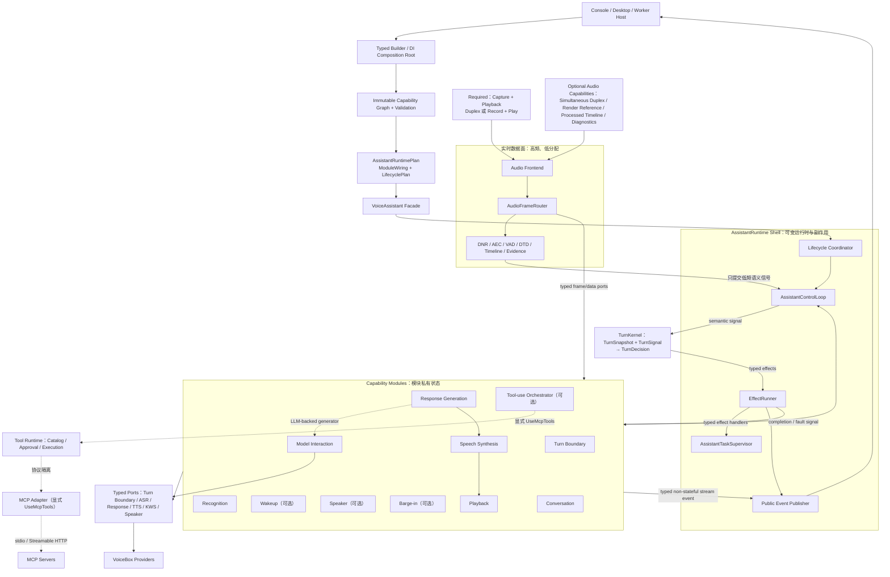
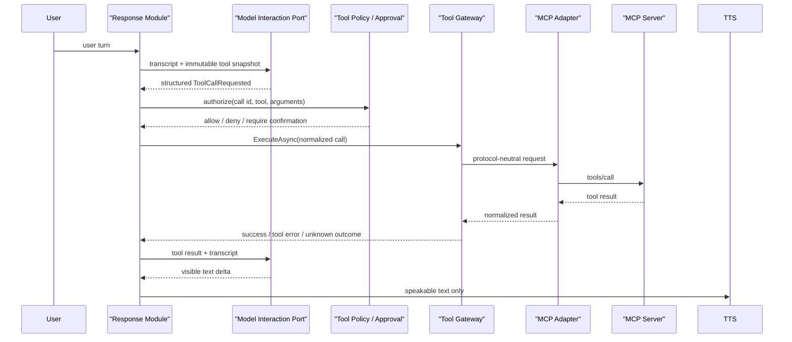

# VoiceBox.Assistant 架构文档

> 适用范围：`src/VoiceBox.Assistant`、`src/VoiceBox.Assistant.Integrations.Mcp`
>
> 相关测试：`src/Tests/VoiceBox.Assistant.Tests/Architecture/`

## 1. 概览

`VoiceBox.Assistant` 是一个端到端语音助手运行时，提供：

- 双工音频输入与播放，或独立录音 + 播放；
- VAD、ASR、LLM、TTS 流式编排；
- 唤醒词与连续对话；
- 说话人验证；
- render-aware barge-in；
- 会话历史、事件通知、生命周期与故障处理；
- 由 LLM 发起、Assistant Host 编排的可选 MCP 工具调用。

架构形态是：

> 模块化单体 + 窄 TurnKernel + AssistantRuntime Shell + Capability Modules + Ports and Adapters + 独立实时数据面

核心设计目标有两条。第一，运行时编排、状态、并发、缓冲区、取消令牌和副作用都必须有唯一所有者，不集中在少数大型类中。第二，可插拔性是一级架构约束：核心只依赖完成一轮会话所需的能力端口，Wakeup、Speaker、DNR、AEC、Barge-in 和 MCP Tools 按能力组合，缺少能力时构建期失败而不是静默降级。

### 1.1 明确不做

以下机制不在架构范围内：

- 灰度发布、新旧实现双跑、影子流量；
- 算法开关、运行时 fallback 或自动回退；
- Assistant 运行期间热插拔模块、动态改变能力图或自动发现插件；
- 缺少能力时静默降级，例如把 render-aware barge-in 自动退化为普通打断；
- 可查询任意服务的通用 `IAssistantPlugin`、`Get<T>()` 或命名字符串插件容器；
- 同时持有状态机、服务、任务、配置和模块注册表的宽泛 `VoiceAssistantKernel`；
- 通过继承 Kernel、共享可变 `AssistantContext` 或任意 handler registry 修改核心状态转移；
- 把逐帧音频、逐 token LLM chunk、TTS PCM 或每 hop DTD 数据送入 Kernel 或通用消息总线；
- 为兼容旧内部实现保留两套执行路径；
- 微服务拆分、跨进程消息总线；
- 未显式调用 `UseMcpTools` 时连接、发现或调用 MCP Server。

在 Builder / 组合根中选择一组不可变能力属于启动前静态装配，不属于算法开关。Assistant 一经 `Build`，能力集合在整个实例生命周期内保持不变；需要改变组合时创建新实例，而不是在运行时切换。

## 2. 总体形态



## 3. 分层与职责边界

采用 microkernel-inspired 的决策内核，但不是「插件继承一个大内核」的插件框架。规范术语只有下面五个：

| 边界 | 唯一职责 | 可以依赖 | 严禁承担 |
|---|---|---|---|
| `TurnKernel` | 定义 Turn 状态、不变量，以及 `Snapshot + Signal -> Decision` 的纯决策 | immutable value、纯 policy | 生命周期、线程、Task、CTS、I/O、日志、配置、Provider、Capability Graph、模块实例 |
| `AssistantRuntime` Shell（协作对象集合） | 由 LifecycleCoordinator、ControlLoop、EffectRunner、TaskSupervisor、TurnContextStore、PublicEventPublisher 分别持有 snapshot 提交、串行控制命令、Effect 执行、任务/资源监管和事件发布 | Kernel、typed ports、预计算 Runtime/Lifecycle plan | 把这些职责重新堆进某一个上帝类；service locator；动态插件发现；算法实现；运行时能力切换 |
| `AssistantRuntime` 门面类型 | 装配协作对象；`StartAsync` / `StopAsync` / `Dispose` | 预计算 plan 与 typed collaborators | 实现功能模块控制端口；拥有 ASR / response / wakeup / speaker / barge-in 状态；声明 `Process*` / `Handle*` / `Accept*` / `Reject*` 工作流；实现白名单以外的接口 |
| Capability Modules | 实现音频、边界检测、识别、回复、合成、输入门、证据和打断等能力；持有模块私有状态 | 自身专用端口、必要的 Kernel signal/effect contracts | 直接写 TurnSnapshot、直接调用 Reducer、直接发布 public event、访问其他模块内部状态 |
| Composition | 解析 provider，构建并验证 Capability Graph，生成静态 wiring 与 lifecycle plan | Hosting、provider adapters、module factories | 参与运行时业务决策或音频热路径 |

「Shell」指上表第二行的协作对象集合，不是 `AssistantRuntime` 类本身。`VoiceAssistant` 只是 Facade。

`AssistantCapabilityGraph` 是构建期模型。验证完成后，它生成强类型不可变的 `AssistantRuntimePlan`、`ModuleWiring` 和 `ModuleLifecyclePlan`；Runtime 只消费这些计划，不持有或查询 Graph。Plans 是构造期数据，不作为万能参数对象传给 Module 或在业务方法间层层传递；Runtime 拆出自己实际需要的 typed components。为诊断保留的 graph snapshot 是只读 DTO，不具备服务定位能力。

`AssistantRuntime` 门面允许实现的接口仅限 `IDisposable`。它不得实现 `IResponseControlSignalPort`、`IRecognitionControlSignalPort`、`IBargeInValidationControlSignalPort`、`IVadSpeakerGateHost`、`IResponseTurnResourcePort`、`IActiveResponseCancellationPort`、`ITurnCompletionPort`、`IAssistantControlLoopHandler`、`IEffectBackgroundScheduler`、`IAssistantControlSignalSink` 中的任何一个。

## 4. TurnKernel 契约

Kernel 的规范计算模型是：

```csharp
TurnDecision TurnKernel.Reduce(
    TurnSnapshot current,
    TurnSignal signal);

internal sealed record TurnDecision(
    TurnSnapshot Next,
    ImmutableArray<AssistantEffect> Effects);
```

`Reduce` 必须满足：相同输入产生相同输出；不修改传入对象；不读取真实时间、随机数或外部状态；不抛出 provider 异常；不产生任何副作用。需要时间、序号或关联信息时，由 Runtime 先生成值并放入不可变 Signal。

进入 Kernel 的只能是影响全局 Turn 不变量的低频语义：

- input gate opened / closed；
- speech started / ended；
- recognition completed / failed；
- response completed / failed；
- playback completed / failed；
- interruption requested / accepted / rejected；
- turn cancelled 或 runtime fault 投影。

Kernel 产生的 Effect 只描述意图：begin/finish recognition、generate/cancel response、stop/clear playback（owner-scoped，不存在 duck/restore）、commit/rollback history、publish stateful public event。Effect 不包含可执行 delegate、Provider 实例、CTS、裸音频 buffer 或可变 service reference。

未开启声纹认证时，近端模块在 DTD 初步接受语音帧后临时降低原回合的播放增益（`PlaybackDuckGain`，默认 0.15），连续 `PlaybackDuckReleaseMs`（默认 200 ms）无新近端证据则恢复；DTD 确认 Interrupt 后仍由 Kernel 停播。临时增益由播放请求所有者管理，在误报、请求结束或取消后恢复，旧候选不能修改新请求的音量。开启声纹认证时不做临时降音量，等待当前候选的 Speaker Match 后停播。

以下内容永远不得成为 Kernel Signal / Effect payload：逐帧 PCM、`ReadOnlyMemory<float>` 的借用引用、逐 token LLM delta、TTS 音频块、每 hop DTD 特征、speaker embedding、MCP wire DTO、logger 或 exception stack。它们通过专用数据端口留在 Runtime / Module 边界；只有规范化完成、失败或业务判定进入 Kernel。

失败进入 Kernel 时使用 owned、immutable、协议无关的 `KernelFailure`（稳定 code / category / component / message key），不携带原始 Exception、stack、provider response 或敏感文本；Runtime 保留原异常用于日志和诊断。

Runtime lifecycle command 与 Turn signal 必须区分。Start / Stop / Dispose 由同一个串行控制循环排序，但交给 Runtime lifecycle state machine 处理，不伪装成 TurnKernel 状态转移。

### 4.1 Signal 目录

Signal 至少携带 `type`、`sourceSequence`、`sourceTick`；涉及回合或异步操作时再携带 `turnId` / `operationId`。

| 稳定 trace discriminant | 语义 | 进入条件 |
|---|---|---|
| `turn.input-gate.changed.v1` | `InputGateChanged` | gate opened / closed 已成为全局 Turn 事实 |
| `turn.wakeup.detected.v1` | `WakeupDetected` | KWS / 会话唤醒已归一化，不含 provider DTO 或 audio |
| `turn.speech.started.v1` | `SpeechStarted` | VAD / TurnBoundary 形成起点；TurnId 由 decision 分配，不由 producer 预判 |
| `turn.speech.ended.v1` | `SpeechEnded` | endpoint 形成，携带来源 duration / tick |
| `turn.authorization.resolved.v1` | `AuthorizationResolved` | speaker / wakeup gate 得到 Match / Reject / Timeout 等协议无关结果 |
| `turn.recognition.session-ready.v1` | `RecognitionSessionReady` | 异步 ASR session prepare 完成并带 operation correlation |
| `turn.recognition.completed.v1` | `RecognitionCompleted` | ASR 得到规范化 final text 或 empty outcome |
| `turn.recognition.failed.v1` | `RecognitionFailed` | ASR prepare / finish 失败或取消，携带 `KernelFailure` |
| `turn.interruption.requested.v1` | `InterruptionRequested` | wake / barge-in 建立或关联当前候选；KWS 开启时须由同窗 Speaker Match 授权停播，关闭时 DTD Interrupt 可直接停播 |
| `turn.interruption.resolved.v1` | `InterruptionResolved` | Accepted / Rejected / Timeout，携带原请求 correlation |
| `turn.response.generated.v1` | `ResponseGenerated` | 可见回复生成完成；逐 delta 不进入 Kernel |
| `turn.playback.started.v1` | `PlaybackStarted` | 第一段实际播放开始的低频边界 |
| `turn.playback.completed.v1` | `PlaybackCompleted` | 播放 drain / tail 完成并带 operation correlation |
| `turn.operation.failed.v1` | `OperationFailed` | Response / Playback 等模块终止失败，携带 component + `KernelFailure` |
| `turn.cancel.requested.v1` | `TurnCancellationRequested` | 当前 Turn 的显式取消语义；Runtime Stop 不是该 Signal |
| `turn.runtime-fault.observed.v1` | `RuntimeFaultObserved` | Runtime fatal fault 被规范化投影到当前 Turn |

结果 enum（Accepted / Rejected / Timeout 等）必须是稳定值，不用 provider exception message 或 CLR type 代替。只属于模块私有 operation、不影响全局 Turn 的事实留在 Runtime / Module contract，不为目录完整强行送入 Kernel。

播放期打断的身份模式由 `Speaker.Confirmation.Enable` 决定：

- 身份确认关闭：忽略在线身份认证，即使安装 Speaker provider 也不调用或等待身份验证。已启用的 DTD 达到 `Interrupt` 时，以 `NotRequired` 授权模式提交一次物理停播，后续正常语义不受 Speaker 限制。唤醒可以不装 Speaker。
- 身份确认开启：已安装的唤醒、播放期打断与连续对话单讲必须通过当前候选 Speaker 验证。KWS 命中或 DTD `Interrupt` 均不能单独产生停止副作用；Speaker Pending/拒绝时原播放及增益保持不变。
- 身份确认与 DTD 均启用：按同一原播放 owner turn、同一 stream epoch 和同一候选采集语音区间并行运行 Speaker/DTD，不能等 DTD `Interrupt` 才调度 Speaker。同窗 Speaker Match 通过后即可独立停播，不等待 DTD `Interrupt` 或再次 KWS 命中；DTD 先通过则仍需等待 Speaker。
- 旧 turn/epoch、其他候选窗口或只有历史身份 prior 的结果不能授权当前停播。合法停止必须按原播放 owner turn 幂等，迟到结果不得清除新播放。

`InterruptionRequested` 可建立待授权候选，但不代表身份已通过；`AuthorizationResolved` 必须进入 Kernel
状态转移。身份确认开启时只有当前候选 Match 才能将 `PendingSpeaker` 转为 `Authorized` 并生成一次
`StopPlayback/ClearPlaybackQueue/CancelResponse` Effect（先停设备音频再取消回复源，保证 owner-scoped 停止
一定命中仍活跃的回复）；不得额外要求 DTD Interrupt。Pending/Denied* 不生成上述 Effect，也不存在任何
增益衰减 Effect。身份确认关闭时 DTD Interrupt 以 NotRequired 进入同一停止门，不伪造 Speaker Match。
停播在端点与 ASR 文本之前发生；ASR 在端点后处理整句文本，只决定是否产生新的语义回合，
不能恢复已合法停止的回复。`Accepted` 的 reason 为 `audio-confirmed`（身份确认关闭）或 `speaker-match`（身份确认开启）。

PCM、embedding 和逐 hop DTD 特征仍留在模块内部；低频候选、授权和停止信号必须携带 owner/candidate/operation
及采集区间关联，经 ControlLoop 串行提交。播放 Effect handler 在实际取消/清队列前再次原子校验原 owner。

### 4.2 Effect 目录

Effect 至少携带 `type`、`effectIndex`、`turnId` 和 owned immutable payload。

| 稳定 trace discriminant | 语义 | typed handler 能力族 |
|---|---|---|
| `effect.input-gate.set.v1` | `SetInputGate` | InputGate |
| `effect.recognition.prepare.v1` | `PrepareRecognition` | Recognition |
| `effect.recognition.finish.v1` | `FinishRecognition` | Recognition |
| `effect.response.generate.v1` | `GenerateResponse` | ResponseGeneration |
| `effect.response.cancel.v1` | `CancelResponse` | ResponseGeneration |
| `effect.playback.clear.v1` | `ClearPlaybackQueue` | Playback |
| `effect.playback.stop.v1` | `StopPlayback` | Playback |
| `effect.history.commit.v1` | `CommitHistory` | Conversation |
| `effect.history.rollback.v1` | `RollbackHistory` | Conversation |
| `effect.public-event.publish.v1` | `PublishStatefulEvent` | PublicEventPublisher |
| `effect.operation.cancel.v1` | `CancelOperation` | Runtime EffectRunner / 目标模块 |
| `effect.turn.complete.v1` | `CompleteTurn` | Runtime TurnContextStore |

Effect 目录同时是静态分发的 coverage catalog。一个 Effect 不能由多个 handler 竞争消费；可选模块缺席导致某 Effect 可达时，Composition 必须在 Build 阶段失败，而不是让 switch 在运行时 no-op。

## 5. Capability Module 扩展协议

模块不是 Kernel 的子类，也不获得 Kernel 引用。接入闭环是：

```text
Module observation/result
        -> semantic AssistantSignal
        -> AssistantControlLoop
        -> TurnKernel decision
        -> typed AssistantEffect
        -> EffectRunner / target module
        -> correlated completion/fault signal
```

1. 每个模块唯一拥有自己的 session、worker、queue、buffer、算法状态和模块级 timeout；这些状态不进入 `TurnSnapshot`。
2. 输入型模块把实现细节归一化为稳定 Signal；Effect 型模块只执行分配给自己的 typed Effect，并返回带 `TurnId` / operation identity 的完成或失败 Signal。
3. `AssistantControlLoop` 是 TurnSnapshot 的唯一提交者。模块不得直接调用 Reducer、修改 snapshot、推进其他模块状态或调用用户事件订阅者。非状态型流式公开增量只交给 Runtime 的专用 typed stream-event sink。
4. EffectRunner 使用构建期生成的强类型 wiring：`sealed record` Effect 层次 + 手写闭合 pattern-matching `switch`，显式调用 `ModuleWiring` 上按能力族暴露的 typed handler。禁止反射分派、`Dictionary<Type, object>`、字符串事件名，或模块自行注册任意状态转换。
5. Runtime `OperationCorrelationGate` 在进入 ControlLoop 前收敛 unknown / duplicate / late operation completion；通过 gate 的 Signal 仍携带 TurnId，TurnKernel 再按当前 snapshot 确定性拒绝 wrong-turn / out-of-state 语义。两层都不得让旧 operation 回写新 Turn。
6. 替换同一能力的 provider / adapter 只需满足相同 module contract，不修改 Kernel。
7. 新能力引入新的全局状态或不变量时，必须显式扩展 `TurnSignal` / `AssistantEffect` / Reducer，并补齐状态模型与 Golden Trace；不能用通用 payload 绕过 Kernel 审查。
8. MCP 是 LLM-backed ResponseGeneration 的内部扩展。只有用户审批等确实改变全局 Turn 语义时才新增协议无关的 Kernel Signal / Effect；MCP DTO 永不进入 Kernel。

Effect 分发的规范形态：

```csharp
ValueTask<EffectExecutionResult> ExecuteAsync(
    AssistantEffect effect,
    CancellationToken cancellationToken)
    => effect switch
    {
        PrepareRecognitionEffect value => _handlers.Recognition.PrepareAsync(value, cancellationToken),
        FinishRecognitionEffect value => _handlers.Recognition.FinishAsync(value, cancellationToken),
        GenerateResponseEffect value => _handlers.ResponseGeneration.GenerateAsync(value, cancellationToken),
        StopPlaybackEffect value => _handlers.Playback.StopAsync(value, cancellationToken),
        PublishStatefulEventEffect value => _handlers.Events.PublishAsync(value, cancellationToken),
        _ => ValueTask.FromException<EffectExecutionResult>(
            new UnreachableException($"Unmapped effect: {effect.GetType().Name}"))
    };
```

`ModuleWiring` 由明确字段和构造参数组成，不退化为通用 handler bag。架构测试维护 concrete Effect catalog，验证每个 Effect 恰好有一个静态分支、每个分支指向声明的能力族、缺失 handler 在 Build 阶段失败，且没有静默 default / no-op。

## 6. 控制面与数据面路由

| 数据 / 事件 | 所属路径 | 是否经过 TurnKernel |
|---|---|:---:|
| PCM、render reference、DNR/AEC/DTD frame、resampler 输出 | Audio Frontend / Realtime 的直接 typed pipeline | 否 |
| VAD / KWS / Speaker / Barge-in 的内部连续证据 | 各模块私有状态 | 否 |
| Speech boundary、授权结果、打断请求与判定 | 低频 semantic signal -> ControlLoop | 是 |
| ASR session 音频 Feed、LLM delta、TTS PCM、playback queue | Effect 执行中的直接 typed stream | 否 |
| Recognition / Response / Playback completed、failed、cancelled | 带 Turn / operation identity 的 semantic signal | 是 |
| 状态、wake mode、Turn 完成等状态型 public event | Kernel Effect -> Runtime Event Publisher | 是 |
| visible / thinking delta 等非状态型 stream event | Module -> typed Runtime StreamEventPublisher | 否；不得反向修改 Turn 状态 |
| telemetry / diagnostics | Runtime / Module decorator 或 snapshot | 否 |

控制面必须完整、有序、可重放；数据面必须低分配、bounded，不为追求统一而绕行 Kernel。

## 7. 逻辑模块与实际目录

逻辑边界是依赖约束的主体，物理目录只是让边界与代码布局一致。架构测试以本节的映射为准，不以目录名字面为准。

| 逻辑边界 | 实际目录 / 文件 | 说明 |
|---|---|---|
| `Abstractions / Public API` | `VoiceAssistant.cs`、`Composition/Builder/VoiceAssistantBuilder.cs` | Typed Builder composition root 与 facade |
| `Abstractions / Events` | `Api/Events/` | 9 个公开事件的 EventArgs 与 enum |
| `Abstractions / Status and failures` | `Api/State/AssistantState.cs`、`Runtime/Control/Models/AssistantFailure.cs` | |
| `Abstractions / Public options` | `Api/Configuration/` | |
| `Abstractions / Tool contracts` | `Api/Tools/Contracts/`、`Api/Tools/Models/` | 宿主实现进程内工具与审批策略所需的 public contract |
| `Kernel` | `Kernel/TurnKernel.cs`、`Kernel/Models/`、`Kernel/Signals/`、`Kernel/Effects/`、`Kernel/Extensions/` | `TurnSnapshot` / `TurnSignal` / `AssistantEffect` / `KernelFailure` / 纯 Reduce |
| `Runtime / Shell` | `Runtime/Lifecycle/`、`Runtime/Control/`、`Runtime/Effects/`、`Runtime/TurnContext/`、`Runtime/Pipelines/`、`Runtime/Gates/` | Shell 是这些协作对象的集合，不是某一个类 |
| `Runtime / Facade` | `Runtime/AssistantRuntime.cs` | 仅接收协作对象集合、转发事件、Start/Stop/Dispose；只实现 `IDisposable` |
| `Runtime / LifecycleCoordinator` | `Runtime/Lifecycle/Controllers/`、`Contracts/`、`Models/` | 启停序列 + 模块拓扑 + 订阅所有者 + 故障收敛 |
| `Runtime / AssistantControlLoop` | `Runtime/Control/Controllers/`、`Contracts/`、`Models/`、`Queues/`、`State/`、`Adapters/` | 有界 MPSC ingress + 单消费者 + typed envelope + 封闭路由 |
| `Runtime / TurnKernel commit` | `Runtime/Control/State/TurnSnapshotStore.cs`、`Runtime/Control/State/TurnStateProjection.cs`、`Runtime/Control/Controllers/AssistantControlLoopTurnWriter.cs`、`Runtime/Control/Projections/AssistantSignalKernelProjection.cs` | 快照唯一持有者与唯一提交者 |
| `Runtime / EffectRunner` | `Runtime/Effects/Execution/`、`Handlers/`、`Contracts/`、`Resources/` | 闭合 switch + 7 个能力族 handler |
| `Runtime / OperationCorrelationGate` | `Runtime/Gates/OperationCorrelationGate.cs`、`Runtime/Control/Queues/CorrelatedObservationQueue.cs` | |
| `Runtime / TaskSupervisor` | `Runtime/Lifecycle/Controllers/AssistantTaskSupervisor.cs` | 同时是 `IEffectBackgroundScheduler` |
| `Runtime / TurnContextStore` | `Runtime/TurnContext/`、`Runtime/TurnContext/Contracts/` | |
| `Runtime / PublicEventPublisher` | `Runtime/Publications/Contracts/`、`Models/`、`Dispatching/`、`Runtime/Effects/Handlers/AssistantRuntimePublicEventEffectHandler.cs` | 统一有序发布边界 |
| `Composition` | `Composition/Builder/`、`Configuration/`、`Graph/`、`Plans/`、`Wiring/`、`Wiring/Models/`、`Exceptions/` | 配置验证与克隆实现位于 `Configuration/`，公开 options 留在 `Api/Configuration/` |
| `Modules / AudioFrontend` | `Modules/AudioFrontend/Adapters/`、`Contracts/`、`Models/`、`Diagnostics/Metrics/` | typed input / output / render / processed / diagnostics 端口 |
| `Modules / TurnBoundary` | `Modules/TurnBoundary/Contracts/`、`Models/`、`Controllers/`、`Adapters/` | `ITurnBoundarySource` + VAD adapter + host seam + ingress |
| `Modules / Recognition` | `Modules/Recognition/Controllers/`、`Contracts/`、`Models/`、`Adapters/`、`Formatting/` | session、pre-ASR 缓冲、识别工作流 |
| `Modules / ModelInteraction` | `Modules/ModelInteraction/Contracts/`、`Models/`、`Modules/Response/Adapters/TextOnlyLlmTurnClientAdapter.cs` | protocol-neutral model / tool contracts |
| `Modules / Response` | `Modules/Response/`、`Runtime/Effects/Resources/ResponseTurnResources.cs` | |
| `Modules / Playback` | `Modules/Playback/Contracts/`、`Models/`、`Controllers/`、`Adapters/`、`Buffering/` | synthesis queue、背压、preroll、drain |
| `Modules / Wakeup` | `Modules/Wakeup/Contracts/`、`Models/`、`Controllers/`、`Adapters/`、`Buffering/`、`Extensions/` | mode / pre-roll / authorization / service adapter + 会话内打断 |
| `Modules / Speaker` | `Modules/Speaker/Contracts/`、`Models/`、`Controllers/`、`Enrollment/`、`Evidence/`、`Profiles/`、`Policies/`、`State/`、`Buffering/`、`Configuration/`、`Diagnostics/`、`Exceptions/`、`Extensions/` | identity tap + ring + 语音门控预取 + evidence cache + policy + 注册 |
| `Modules / BargeIn` | `Modules/BargeIn/Contracts/`、`Models/`、`Controllers/`、`Adapters/`、`Policies/`、`State/`、`Buffering/`、`RenderAware/` | 候选所有者、验证回合所有者、打断裁决、数据面控制器；RenderAware 也按契约、模型、控制器、估计器、策略分类 |
| `Modules / Conversation` | `Modules/Conversation/Contracts/`、`Models/`、`Stores/` | |
| `Realtime / AudioFrameRouter` | `Realtime/Routing/AudioFrameRouter.cs` | |
| `Realtime / Buffers` | `Modules/BargeIn/Buffering/NearEndAudioReservoir.cs`、`Realtime/Timeline/BoundedFractionalRenderBuffer.cs`、`Runtime/Control/Queues/BoundedMpscQueue.cs` | |
| `Realtime / Resampling` | `Realtime/Resampling/AudioResamplerPool.cs` | |
| `Realtime / Timeline` | `Realtime/Timeline/AdaptiveRenderDelayTracker.cs`、`RenderAlignmentStage.cs`、`Timeline*Resampler.cs` | |
| `Diagnostics` | `Diagnostics/Benchmarking/`、`Metrics/`、`Recording/` | Benchmarking 内分 `Contracts/`、`Models/`、`Adapters/`；指标快照在 `Metrics/Models/` |
| `Hosting` | `Hosting/VoiceAssistantServiceCollectionExtensions.cs`、`Configuration/`、`Lifecycle/`、`Diagnostics/`、`Models/`、`Telemetry/` | DI、options 验证、hosted lifecycle、diagnostics、tracing/metrics；不属于 Runtime 或 Modules |
| `Integrations / Mcp` | `src/VoiceBox.Assistant.Integrations.Mcp/` | 独立程序集，唯一允许引用 MCP SDK 的位置 |

### 7.1 程序集边界

`Kernel`、`Runtime`、`Modules`、`Hosting` 共处 `VoiceBox.Assistant` 单个程序集。它们共享一组内部 typed plans，没有独立依赖、测试或发布价值，因此不为目录对称拆成空程序集；边界由本文的依赖规则加架构测试锁定。`VoiceBox.Assistant.Integrations.Mcp` 是唯一独立的物理边界，因为它需要隔离 `ModelContextProtocol.*` 包依赖。

允许的依赖方向：

```text
Composition ──▶ Runtime ──▶ Kernel
     │            │
     │            ├──▶ Modules ──▶ Kernel（仅 immutable Signal/Effect/value）
     │            └──▶ Realtime
     └──▶ Modules / Realtime / providers

Hosting namespace ──▶ (Composition | Runtime | Abstractions)      # 逻辑反向禁止
Kernel  ──▶ 仅 Abstractions 与自身 pure value/policy
Integrations.Mcp ──▶ Api/Tools + Composition hook              # 核心不反向依赖
```

### 7.2 源文件组织约定

先按功能模块定位代码，再在模块内按职责分类：

- `Contracts/` 只放接口；请求、结果、快照、枚举等数据类型放在 `Models/`。
- `Controllers/` 放工作流与协调实现，`Adapters/` 放边界适配和空实现，`Policies/` 放判断规则。
- `State/` 放主动管理可变状态的实现，`Buffering/`、`Queues/` 放缓冲与队列，`Stores/` 放存储实现。
- 注册、证据调度、profile 等聚集的实现分别放在 `Enrollment/`、`Evidence/`、`Profiles/`；仅在有对应职责时建立目录。
- `Configuration/` 放选项或配置处理，`Exceptions/`、`Extensions/`、`Telemetry/` 分别放异常、扩展方法和遥测实现。
- 每个文件只包含一个顶层类型，文件名与类型名一致；嵌套的私有辅助类型留在所属类型内。

`Api/Events/`、`Api/Playback/`、`Api/State/` 和 Kernel 的 `Signals/`、`Effects/` 已表达数据用途，保持这些专用目录。`Composition/Plans/` 也保持计划类型的聚合。此次整理保留既有命名空间、类型可见性及公共 API；职责子目录不要求增加新的命名空间层级，调用方和反射契约继续使用原类型全名。

## 8. 依赖规则

1. `Kernel` 不引用音频设备、ASR、LLM、TTS、logging、文件系统、具体 DTD、Runtime、Composition 或 Modules。
2. `Kernel` 不启动任务、创建线程、持有 CTS、读取真实时间或接收可执行 delegate / 可变 service reference。
3. `Runtime` 可以依赖 Kernel contracts、typed module ports 和不可变 Runtime/Lifecycle/Wiring plan，但不引用具体 provider 实现或 `AssistantCapabilityGraph`。
4. RenderAware / WebRTC 具体类型只存在于 `Realtime` / `Integrations` 边界。
5. feature 模块之间不通过互相持有具体类形成横向依赖；协作通过 signal、effect 或小型专用端口完成。
6. `IAudioServiceManager` 不出现在 `VoiceBox.Assistant` 的任何位置；宿主自行解析 provider 后通过类型化 Builder 注入。
7. 对外事件只由统一发布器发出，模块不直接调用用户订阅者。
8. 配置在 Runtime 创建时转换为不可变内部快照，运行期不被外部引用修改。
9. `Response` 只依赖协议无关的 Response Generation 端口；LLM-backed generator 再依赖 Model Interaction 端口。二者都不依赖 OpenAI、ONNX 或 MCP SDK 类型。
10. `Kernel`、`Conversation` 和 `Playback` 不引用 `ModelContextProtocol.*` 或 MCP wire DTO。
11. MCP wire model、transport、版本协商、授权与 SDK 生命周期只存在于 `VoiceBox.Assistant.Integrations.Mcp`。
12. Tool Adapter 只返回规范化结果，不直接发布 Assistant event、修改 history 或调用 TTS。
13. MCP Server 地址、stdio executable 和授权信息只来自受信任配置；模型输出和用户语音不得动态指定 server / command。
14. 不设计万能插件接口。音频处理器、回合边界、识别、回复生成、合成、输入门和工具是不同扩展轴，各自使用小型类型化端口。
15. `AssistantCapabilityGraph` 只用于描述、验证和生成诊断快照，不暴露 `Get<T>()`、按名称查询或运行时定位服务的能力。
16. DNR、HPF、AEC 等采集处理属于 Audio Frontend；Kernel 和 Response 只接收规范化音频帧、低频判定或专用 diagnostics，不依赖具体算法服务。
17. Module 可以依赖 Kernel 的 immutable Signal / Effect / value contracts，但 Kernel 不反向依赖任何 Module；Composition 是唯一同时知道 Runtime、Modules 和 provider adapters 的外层。
18. 状态型 public event 必须由 Kernel Effect 明确描述、由 Runtime publisher 执行；非状态型流式增量可由 Module 交给专用 Runtime stream publisher。两者都禁止 Module 直接调用用户订阅者，stream event 也不得反向改变 Turn 状态。
19. 模块间高吞吐数据传递使用专用 typed port；影响全局 Turn 的控制协作只经 ControlLoop -> Kernel，不直接横向推进另一模块状态。
20. `IServiceProvider` 只出现在 `Hosting/VoiceAssistantServiceCollectionExtensions.cs` 的外层组合工厂中，核心其余位置不得出现。

## 9. 并发与所有权

1. 生命周期状态与对话状态分离：
   - Runtime：Created、Starting、Running、Stopping、Stopped、Faulted、Disposed；
   - Conversation：Idle、Listening、Recognizing、Thinking、Speaking。
2. Runtime lifecycle state 只有 `LifecycleCoordinator` 一个写入者；当前 TurnSnapshot 只有 `AssistantControlLoop` 一个提交者，所有新值必须来自纯 Kernel decision。
3. 音频热路径不执行 `await`、文件/网络 I/O 或用户回调。
4. 音频热路径不使用通用 MediatR / EventBus。
5. 控制消息不得静默丢弃；可合并消息与不可丢消息分别定义。
6. 每个 Turn 唯一拥有自己的 CTS、ASR session、response task 和 playback session。
7. 创建资源的组件负责释放资源；禁止多个组件共同 Dispose 同一对象。
8. 所有后台任务必须登记到 `AssistantTaskSupervisor`，禁止未监管的 fire-and-forget。
9. 不在锁内调用 provider、用户回调、日志 provider 或其他不可控代码。
10. 仍需使用锁的实时组件必须遵守 9.2 的锁顺序，禁止反向嵌套。
11. 外部注入的 provider 默认为 `Borrowed`；Assistant 自己创建的 adapter、session、CTS、buffer 和 worker 是 `AssistantOwned`。任何例外必须在组合契约中显式声明。
12. 模块按能力依赖的拓扑序启动，按逆序停止和释放；部分启动失败时只回收已经成功启动且由 Assistant 持有的资源。
13. 当一个对象同时满足 Capture 和 Playback（例如双工服务）时，生命周期协调器按对象身份去重，确保 Start / Stop exactly once；`AssistantOwned` 对象 Dispose once，`Borrowed` 对象 Dispose zero。
14. EffectRunner 启动的每个异步 operation 必须带 TurnId / operation identity，并最终产生 exactly-once completion、fault 或 cancellation signal；迟到结果不污染后续 Turn。
15. Capability Graph 在 Runtime 启动前生成 `ModuleLifecyclePlan`；生命周期协调器消费该 plan，不在 Start / Stop 期间重新查询 capability 或 provider。
16. `PublicEventPublisher` 是调用用户订阅者的唯一组件；stateful publish effect 与 non-stateful stream event 汇入同一有序发布边界（见第 10 章）。

### 9.1 AssistantControlIngress

控制入口是**有界 MPSC 语义队列 + 单个非音频线程消费者**。可以使用两个物理 lane（critical Turn signal 与 lifecycle/async completion）保证实时 producer 的容量，但它们共享一个全局 `IngressSequence`，由 consumer 以该序列做确定性 merge；lane 不用于隐式优先级或重排。队列只承载 `RuntimeCommand` / `AssistantSignal` 的 typed envelope；PCM、DTD hop、speaker score、LLM delta、TTS PCM、telemetry 和 stream event 永不进入该队列。

每个 `ControlEnvelope` 在来源处一次性取得：严格单调的 `IngressSequence`、单调 `SourceTimestamp` 和来源类别，以及必要的 TurnId、operation identity 与 immutable payload。

单消费者按 `IngressSequence` FIFO 提交。普通 lifecycle command 与 Turn signal 不设隐式优先级；`Stop` / `Dispose` 是有序 barrier：barrier 之前已接受的消息按既有语义 drain 或 cancel，barrier 之后的 Turn signal 确定性拒绝。Fatal 与 overflow 只通过显式 terminal latch 唤醒消费者，并在当前 decision commit 后收敛，不从音频线程直接改状态。

| 消息类别 | admission / backpressure | overflow 语义 |
|---|---|---|
| speech boundary、wakeup / authorization / interruption decision | 音频线程只做 allocation-free、non-blocking `TryEnqueue`；Build 时为 critical lane 保留容量 | 支持负载包络内必须为 0 次；一旦容量不变量被破坏，原子记录 `ControlIngressOverflow` terminal fault 并唤醒消费者，禁止 drop-oldest / drop-newest、阻塞、日志或用户回调 |
| recognition / response / playback completion、fault / cancel | 非实时 producer 可带 CancellationToken 异步等待容量；不得重复或丢失 | 超时或 ingress 已终止时生成唯一 Runtime fault，不改投新 Turn |
| Start / Stop / Dispose | 保留 lifecycle admission；调用线程可异步等待，Stop / Dispose 必须能唤醒消费者 | 不得静默丢弃；按有序 barrier 收敛 |
| 可合并 hint、metrics、diagnostics | 不进入控制队列；使用模块私有 latest snapshot / counter | latest-wins 仅限明确声明的非业务诊断数据 |

音频回调产生 semantic signal 时只允许规范化、打时间戳和序号、入队，然后立即返回；不得同步直通 Reducer，也不得 `await`、阻塞、自旋等待、分配、调用 provider、记录日志或调用用户代码。依赖时间窗口的 Kernel policy 使用**来源时间**而不是 dequeue 时墙钟时间，避免排队抖动改变 `PlaybackStartupGuardMs`、candidate suppression 或 validation timeout 的语义。

在 160 / 256 / 320 samples 的 callback 配置及支持负载包络内必须同时满足：

1. audio producer 入队路径为 0 allocation；
2. `enqueue accepted -> reducer start` 的 p99 不超过 1 个对应 capture callback period，最大值不超过 2 个 period；
3. interruption 等实时 decision 的 `source timestamp -> effect issued` 不比同步路径新增超过 1 个 callback period；
4. capacity-1、capacity、capacity+1、Stop barrier 与 fatal 同时到达均有确定性测试；支持负载用例不触发 overflow，capacity+1 故障用例按上表收敛且音频线程不阻塞。

不得通过扩大成无界队列、放宽预算或同步直通状态机来规避这些约束。

### 9.2 锁顺序

实时数据面不获取生命周期锁或控制命令锁。一条路径需要多个锁时，顺序从外到内固定为：

1. `AssistantRuntime._lifecycleLock`
2. `AssistantRuntime._controlCommandLock`
3. `TurnContextStore._lock`
4. 模块局部锁（barge-in journal / coordinator、recognition owner）
5. 发布边界的 admission / progress 锁

识别模块内，`RecognitionModule._lock` 总是先于 `RecognitionSession` 锁获取。仅涉及 session 的音频 admission / drain 路径可以在不持模块锁的情况下获取 session 锁，但必须先释放再获取模块锁。Provider 调用始终在两个锁之外。

`ActiveNearEndCoordinator._lock` 是近端采集的唯一数据面锁。`NearEndEndpointPolicy`、`NearEndSpeakerCandidateState`、`NearEndCaptureSession` 三个所有者类型没有私有锁；对它们的每次修改都发生在 coordinator 已持有 `_lock` 时。`NearEndCaptureSession.ReadActiveTurnIdVolatile()` 是唯一的无锁读，存在的目的仅是让双工回调在取 `_lock` 前跳过非活跃帧。给这些所有者类型添加第二把锁必须同步更新本节与 endpoint 交错契约测试。

`WakeupSessionGate._lock` 保护 mode / timeline / authorization 状态。其 `WakeupDetectorAdapter` 拥有一个独立的 provider gate，仅用于串行化 detector 调用；它不与 gate 锁一同获取，且 detector provider 总是在所有状态锁释放之后调用。较新的 lifecycle 版本会使过期的 start / feed / restart 失效，因此 Stop / Dispose 之后不会再出现 detector Feed 或复活的 Start。同步 provider 回调可以请求嵌套转换，adapter 以可重入方式处理而不等待自己的 provider gate。

Provider 调用、用户回调、logging provider、`await` 和阻塞等待在持有任何锁时都被禁止。音频回调只允许读取不可变投影并入队一个有界 typed signal；不得获取生命周期锁或控制命令锁。provider gate 不是状态锁，不得用它重新引入「锁内调用 provider」。

新增嵌套锁必须先写入本节并被并发压力测试覆盖，才能进入生产使用。

## 10. 有序发布边界

状态型 public event（Kernel Effect 驱动）与非状态型 stream event（模块直交）最终都经过**同一个** `OrderedPublicationBoundary` 调用用户订阅者。

### 10.1 排序键：PublicationSequence

`PublicationSequence` 是 Runtime 级单个严格单调计数器（`Interlocked` 递增，无分配），与 `IngressSequence` 相互独立：ingress 序号解决控制面的确定性归并，publication 序号只解决对外发布的全序。取号点只有三类：

| Producer | 取号时机 | 顺序来源 |
|---|---|---|
| `AssistantControlLoop`（stateful publish effect） | commit 一个 decision 时，按 `effectIndex` 顺序为其每个 publish effect 取号 | ControlLoop 是 TurnSnapshot 唯一提交者，decision 顺序即因果顺序 |
| `LifecycleCoordinator`（启动 / 停止等 lifecycle 发布） | 处理 RuntimeCommand 产生发布时取号 | 单控制循环内的命令顺序 |
| 模块 typed stream endpoint（如 `AssistantText` 增量） | 交付事件给边界的当下取号；处于栅栏中的事件在栅栏解除后交付时才取号 | 每模块单 producer 单 endpoint，天然 FIFO |

设计不变量是**取号即承诺**：取号与交付必须在同一个无 `await` 的同步片段内完成，任何已取号的事件必然随后到达边界；fault 路径上 ControlLoop 停止取号，并向边界推送终止水印。因此边界只会短暂等待「已在途中」的序号，不会等待一个永远不会被取的号。

stateful 事件在 commit 时取号而不是在 signal 入队时取号，因为入队时刻的因果尚未经过 Reducer 决策：一个 signal 可能产生零个或多个 publish effect，也可能被确定性拒绝。只有 commit 时刻才能确定该 decision 实际产生哪些发布及其顺序。模块流事件与某个 decision 之间的因果由「启动该异步 operation 的 effect 在 commit 时先取号」自然建立。

### 10.2 释放规则

- **R1 单一边界**：所有对外事件由 `OrderedPublicationBoundary` 按序释放给 `PublicEventPublisher`；后者是调用用户委托的唯一组件，沿用逐订阅者 try/catch + 日志隔离语义和同一 `sender` 对象（`VoiceAssistant` facade 实例）。
- **R2 严格升序释放**：边界只释放序号等于 `nextExpected` 的事件；乱序到达者进入内部缓冲。缓冲无需上限配置，「取号即承诺」保证乱序窗口只是调度抖动尺度。
- **R3 gap 看门狗**：`nextExpected` 超过构建期配置的预算仍未到达，视为不变量破坏，产生唯一 Runtime fault 收敛；不跳号、不无限等待、不静默丢弃。
- **R4 Stop barrier 与 drain**：Stop / Dispose barrier 之后不再产生新取号；已取号事件全部释放后，`StateChanged(→Stopped)` 以其最大序号天然最后发布。barrier 后的业务事件不得排在 Stopped 之后。
- **R5 取消语义**：turn 取消或 fault 时，模块尚未交付的 stream event 直接丢弃（已发布的不回收、未发布的不补发）；已交付边界的事件照常释放。
- **R6 执行上下文**：边界在自身单一上下文上同步调用用户委托。订阅者阻塞只延迟后续发布，不阻塞音频线程或响应任务线程；订阅者异常逐订阅者隔离并记录。
- **R7 首可见增量栅栏**：`StateChanged(→Speaking)` 是全部公开事件中唯一由流内容触发的状态转移。Response 模块的 stream endpoint 在提交 `response.speakable-started` 语义 Signal 后，对本 turn 首个 visible delta 的**公开事件与 TTS feed** 同时施加栅栏；边界在释放对应的 `StateChanged(→Speaking)` 时开栅。栅栏同时闸住 TTS feed 是为了保持「状态事件先于首次合成入队」的顺序。栅栏等待上界为 9.1 的 ingress 延迟预算，且只作用于非实时模块线程；播放 preroll 窗口远大于控制循环一次空转，首音延迟无可测影响。每个 turn 最多栅栏一次；其后的 delta 零附加延迟。turn 取消、故障或未发生转移时栅栏按 R5 abandon。
- **R8 栅栏唯一性**：`AssistantText` 是唯一高频流式事件，EO-08 是唯一由流内容驱动的状态转移（其余转移均由 speech boundary、识别/播放完成、唤醒/barge-in 判定、fault 等低频语义触发）。未来任何「由流事件触发状态转移」的新需求都必须新增显式栅栏声明，不得隐式绕过本章。

### 10.3 事件顺序约束

下表是有保证的事件顺序（`≺` 表示对订阅者可见的严格先后）。这些约束由 Golden Trace 逐条固化，任何删减或放宽都是业务变更。

| ID | 约束（前者 ≺ 后者） | 保持机制 |
|---|---|---|
| EO-01 | 启动路径 `StateChanged(→Idle)` ≺ `WakeModeChanged(→WaitingForWakeWord)` | Start barrier 后同一 lifecycle 发布序列 |
| EO-02 | 同一唤醒判定内 `WakeModeChanged` ≺ `WakeupDetected` | 同一 observation 的 mode 变化与唤醒检出投影为单个 Signal，由同一 decision 的 effectIndex 保序 |
| EO-03 | 初始唤醒链 `WakeupDetected` ≺ 后续 `StateChanged(→Listening)` | ingress FIFO |
| EO-04 | `StateChanged(→Listening)` ≺ `StateChanged(→Recognizing)`（仅非验证回合发布 Recognizing） | ingress FIFO + 条件性发布由 Kernel Effect 显式表达 |
| EO-05 | `StateChanged(→Recognizing)` ≺ `UserSpoke` | ingress FIFO |
| EO-06 | `UserSpoke` ≺ `StateChanged(→Thinking)` | 同一 decision 内 effectIndex |
| EO-07 | `StateChanged(→Thinking)` ≺ 本 turn 首个 `AssistantText`（含 thinking） | commit 时 Thinking 先取号；`GenerateResponse` 的异步执行随后才启动 |
| EO-08 | `StateChanged(→Speaking)` ≺ 本 turn 首个 visible `AssistantText` | 首可见增量栅栏（R7） |
| EO-09 | `AssistantText` 流内 FIFO；thinking / visible 交错顺序与 LLM chunk 顺序一致 | 单 producer 单 endpoint，交付时取号 |
| EO-10 | `AssistantResponseGenerated` ≺ `AssistantReplied` | `response.generated` 与 `playback.completed` 两个 Signal 的 ingress FIFO |
| EO-11 | `AssistantReplied` ≺ `StateChanged(→Idle)` | turn.complete 决策殿后 |
| EO-12 | `BargeInValidation(Heard)` ≺ `BargeInValidation(Accepted/Rejected)`（同一 validation turn；`Accepted` 在端点与 ASR 文本之前发布，reason 为 `audio-confirmed` 或 `speaker-match`；整句 ASR 为空/填充词/回声文本时不再发布第二个事件，回合直接无回复结束） | `interruption.requested` → `interruption.resolved` 的 ingress FIFO |
| EO-13 | `BargeInValidation(Accepted)` ≺ `StateChanged(old→Listening)`（条件：`old≠Listening`） | 同一 decision 内 effectIndex |
| EO-14 | `BargeInValidation(Rejected)` ≺ `StateChanged(old→restored)`（条件：`old≠restored`）≺ 可能的 `WakeModeChanged(→WaitingForWakeWord)` | 同一 decision 内 effectIndex；Rejected 与连带 WakeMode 变化来自同一 Signal 的 decision |
| EO-15 | `Heard` 发布时刻不伴随 `StateChanged`（状态保持 Speaking） | Kernel：`interruption.requested` 不产生状态转移 Effect |
| EO-16 | `Faulted` ≺ `StateChanged(→Stopped)` | terminal latch 收敛先于 Stop barrier 处理；Stopped 取号最大 |
| EO-17 | 启动 `StateChanged(→Idle)` ≺ 任何 turn 事件；停止时 `StateChanged(→Stopped)` 是最后一个业务事件 | Start / Stop barrier 语义 + R4 |
| EO-18 | 每 turn exactly-once：`UserSpoke` / `AssistantResponseGenerated` / `AssistantReplied` ≤1；`Heard` / `Resolved` ≤1；`StateChanged` 无 `From==To` 或重复转移 | Kernel 不变量 + 取号唯一 + R2 |
| EO-19 | 全部事件 `sender` 为同一 `VoiceAssistant` 实例 | R1 |

### 10.4 显式无序对

以下事件对没有顺序保证（跨线程或依赖调度），不得虚构顺序。它们不是精确轨迹的断言对象，只能归一化：

- UO-01：播放期音频线程事件（`Heard`、barge-in 相关 `StateChanged`）与响应线程事件（`AssistantText`、`AssistantResponseGenerated`、`AssistantReplied`）之间的交错；
- UO-02：stop / clear 等播放操作与文本事件的相对时刻；
- UO-03：取消或故障路径上「已发布事件集合」的截断点；
- UO-04：订阅者阻塞对生产者的反压差异（见 R6）。

## 11. 设计模式

| 模式 | 使用位置 |
|---|---|
| Facade | `VoiceAssistant` 对外入口 |
| Builder / DI | Assistant 组合根与模块配置 |
| Ports and Adapters | Audio、Turn Boundary、ASR、Response Generation、LLM、TTS、KWS、Speaker |
| State Machine / Reducer | Runtime lifecycle 与纯 TurnKernel 状态转移；二者分离 |
| Strategy | wakeup、barge-in、speaker、conversation policy |
| Pipeline / Composite | Audio Frontend 处理链和 Response -> TTS -> Playback |
| Observer | 对外事件与诊断事件 |
| Supervisor | 后台任务、取消、故障收敛 |
| Factory / Pool | session、detector、resampler、buffer lease |
| Decorator | telemetry |
| Anti-Corruption Layer | LLM provider / MCP SDK DTO 与 Assistant 内部模型之间的映射 |

不为模式而模式化：不允许每类一个接口、万能 `AssistantContext`、泛型 Repository、深层继承体系、高频帧消息总线或通用 `VoiceAssistantKernel`。Kernel 扩展使用组合与显式协议演进，不使用继承。编码时权衡功能大小和设计成本，避免过度设计和无意义抽象。

接口按业务职责与实际消费者划分：重复的状态视图、无独立用途的继承层和始终成组绑定的同一业务端口应合并；实时音频、语义控制、生命周期与诊断仍保留独立边界。具体关系和合并依据见 [Assistant 接口业务关系与合并依据](voicebox-assistant-interface-consolidation.md)。

## 12. 能力组合

可插拔性的单位是「能力」，不是「任意对象」。`TurnKernel` 只负责 Turn 状态、不变量和 Effect 决策；任务、取消、资源和实际 Effect 执行属于 Shell。二者都不知道当前用了哪种具体 provider，也不把所有可选服务作为 nullable 字段保存。

### 12.1 最小能力集

完成一次自动语音问答需要下列角色。双工服务可以同时提供前两项，但「双工」本身不是最小问答组合中必须单独存在的能力角色：

| 能力角色 | 基础组合是否必需 | 实现适配来源 | 说明 |
|---|:---:|---|---|
| `AudioCapture` | 是 | `IAudioDuplexService` 或 `IAudioRecordService` | 提供有序采集帧及明确音频格式 |
| `AudioPlayback` | 是 | `IAudioDuplexService` 或 `IAudioPlayService` | 承接 TTS 音频、drain、clear 和播放状态 |
| `TurnBoundary` | 是 | `IVoiceActivityDetectService` | 决定何时开始 / 结束识别；也可由按键或宿主 endpoint 提供 |
| `SpeechRecognition` | 是 | `IASRService` | 将一个完整语音 Turn 转为文本 |
| `ResponseGeneration` | 是 | `IStreamLLMService` adapter | 生成回答；也可由规则、业务回调或其他模型实现 |
| `SpeechSynthesis` | 是 | `IStreamTTSService` | 将可播报文本转换为播放音频 |

「双工（或录音 + 播放）+ ASR + TTS」表达了主要媒体链路，但还隐含 `TurnBoundary` 与 `ResponseGeneration` 两个必要角色。它们必须显式进入类型系统，否则会重新变成 Runtime 中的隐藏依赖。

### 12.2 组合 Profile

| Profile | 组成 |
|---|---|
| `BasicDuplexQa` | Duplex + TurnBoundary + ASR + ResponseGeneration + TTS，不装配增强模块 |
| `BasicDuplexQa` 全栈堆叠 | 上一行 + Wakeup + Speaker + Barge-in | 
| `BasicSplitAudioQa` | Record + Play + TurnBoundary + ASR + ResponseGeneration + TTS |

`BasicSplitAudioQa` 不声明 render-aware 能力，因此不能装配 render-aware barge-in。全栈堆叠是声学与端到端评测的锚定组合。

### 12.3 类型化 Builder

```csharp
var assistant = VoiceAssistant.CreateBuilder()
    .UseAudio(duplex)
    // 或 .UseAudio(record, playback)
    .UseTurnBoundary(vad)
    .UseSpeechRecognition(asr)
    .UseResponseGeneration(llm)
    .UseSpeechSynthesis(tts)
    .AddWakeup(wakeup)
    .AddSpeakerVerification(speaker)
    .AddBargeIn(bargeInOptions, acousticPathDelayEstimatorFactory)
    .Build();
```

组合规则：

- `UseXxx` 表示恰好一个必需角色，重复设置报错，不是 last-write-wins；
- `AddXxx` 安装一个可选能力模块；`Wakeup.Enable` 与 `BargeIn.Enable` 由 Builder 依注册事实推导。在线本人确认由 `Speaker.Confirmation.Enable` 统一开关：开启时必须已安装 Speaker，不能因 Speaker 缺席而推导成无需认证；关闭时唤醒可以不装 Speaker；
- 身份确认关闭时忽略在线身份认证：即使安装了 Speaker provider，也不生成在线 verifier、身份 feed/gate 或在线 profile 依赖；独立注册功能仍可显式使用 provider。身份确认开启且 Barge-in 启用时，BargeInCommand 身份 purpose/bank 也为必需；单讲 purpose 随 Enable 一并打开；
- `VoiceAssistantBuilder` 是唯一 composition root；
- Builder 只接收类型化 service / port / option，不接收 `IServiceProvider`、`IAudioServiceManager`、字符串 type name 或反射扫描结果；
- keyed / named provider 的选择只发生在 Hosting；选定实例必须在 `Build` 前解析完成，Runtime 不接收 provider name 并二次查找；
- `Build()` 生成不可变 composition snapshot。启动后不能增加、移除或替换模块；
- optional module 未添加时不启动空 worker，也不解析其 provider。数据面热路径上为避免 nullable 分支而使用的惰性 no-op 实现是允许的实现细节，但必须不解析 provider、不订阅事件、不创建 task/CTS、不产生诊断副作用，且不出现在 lifecycle plan 或 capability snapshot 中；
- 组合错误使用稳定的错误码（`VBX-COMP-xxx`）和可诊断消息，明确指出请求的模块、缺少或冲突的能力和来源。

### 12.4 Capability Graph

`AssistantCapabilityGraph` 是构建期验证模型。节点描述模块，边描述强类型的 `Requires` / `Provides` 关系；能力标识使用封闭的内部枚举，不使用散落字符串。验证成功后输出不可变的 Runtime / Lifecycle / Wiring plans，Graph 本身不进入 Runtime。

建模的能力集合：

```text
AudioCapture                 AudioPlayback
CaptureTimeline              SimultaneousCapturePlayback
RenderReference              CaptureProcessorStage
ProcessedCaptureTimeline     AcousticProcessingDiagnostics
SpeakerCaptureTimeline
TurnBoundary                 SpeechRecognition
ResponseGeneration           SpeechSynthesis
WakeupGate                   SpeakerEvidence
BargeIn                      StructuredToolUse
```

Graph 必须在订阅事件、创建后台任务或启动 provider 之前完成验证：

1. 所有 single-cardinality 必需角色恰好有一个提供者；允许多实例的 pipeline stage 必须有唯一模块 ID 和显式顺序；
2. optional module 的依赖全部满足；
3. 不存在互斥能力、循环启动依赖或重复唯一能力；
4. Capture / Playback / ASR / TTS 的 sample rate、channels、sample format 和所需时间线可协商；
5. 共享实例的生命周期和所有权声明一致；
6. 当前 provider 确实支持声明的能力，不由类名或 Options 猜测；
7. 组合 Profile ID、能力边和音频格式可生成稳定、脱敏、可比较的 snapshot 与 SHA-256 hash。

Capability Graph 只做验证、生成启动 / 路由计划和诊断 snapshot，不参与业务热路径，也不演变为 Runtime 的服务查询容器。

### 12.5 模块类别与能力约束

不同类别使用不同契约，不设计万能 `IAssistantPlugin`：

| 类别 | 示例 | 组合方式 |
|---|---|---|
| Audio endpoint adapter | Duplex、Record + Play | 提供 Capture / Playback 及可选同步时间线能力 |
| Capture processor | DNR、HPF、AEC | 在 Audio Frontend 的有序静态 pipeline 中组合 |
| Input gate / evidence | Wakeup、Speaker verification | 消费 capture timeline，向控制面提交低频 gate / evidence signal |
| Turn boundary | VAD、push-to-talk、external endpoint | 恰好选择一个 endpoint policy |
| Turn stage | ASR、ResponseGeneration、TTS | 通过专用 session / stream port 串联 |
| Interruption policy | 普通 Barge-in、render-aware Barge-in | 根据声明的音频与 evidence 能力校验 |
| Response tool extension | MCP Tool Gateway | 只扩展结构化 Model Interaction，不进入音频数据面 |

能力约束矩阵：

| 模块 | Requires | Provides | 缺失时行为 |
|---|---|---|---|
| DNR / HPF | 上一 capture stage + 匹配的音频格式 | 有序 `CaptureProcessorStage` | 构建失败，不绕过处理器 |
| AEC | capture stage + `AudioPlayback` + `RenderReference` + 已知时钟关系 | 有序 `CaptureProcessorStage`、可选 diagnostics | 构建失败，不自动退化为无 AEC |
| Wakeup | `AudioCapture` + `CaptureTimeline`；`Confirmation.Enable` 时另需 `SpeakerEvidence` + Wakeup 身份 purpose/profile | `WakeupGate` | 身份确认开启时缺少 Speaker 构建/启动失败；关闭时允许无身份唤醒 |
| 在线 Speaker verification | `Speaker.Confirmation.Enable` + `SpeakerCaptureTimeline`（capture processor/AEC/APM 后、独立 DNR 前）或经声明的 capture timeline + profile | `SpeakerEvidence` | Enable 时为必需；关闭时不装配在线身份门，不因在线身份依赖缺失失败 |
| SingleTalk（逐句复核） | `Speaker.Confirmation.Enable` + `SpeakerEvidence` + 可定位 `ProcessedCaptureTimeline` + `cleanNearEnd` bank | 不新增 public capability；Listening 回合以 `PendingSpeaker` 打开 | 随 `Confirmation.Enable` 一并开关。开启时缺 timeline/profile/bank 构建失败，不降级为无身份单讲 |
| Basic Barge-in | `SimultaneousCapturePlayback` + `TurnBoundary` | `BargeIn` | 构建失败，不静默关闭 |
| Render-aware Barge-in | Basic Barge-in 的依赖 + `RenderReference` + `ProcessedCaptureTimeline` + DTD adapter | `BargeIn` + diagnostics | 构建失败，不自动改用 basic 模式 |
| MCP tools | `ResponseGeneration` + `StructuredToolUse` + Tool Catalog/Approval/Executor | tool-augmented response | 构建失败，不解析普通文本模拟 |

对 optional module 做组合时，请求该模块就必须满足其依赖。`Speaker.Confirmation.Enable` 的依赖包含 Speaker 身份验证，不能因未调用 AddSpeakerVerification 而放宽；关闭时不解析在线身份依赖，KWS 可以单独安装。Barge-in 的纯声学能力按原依赖校验，身份确认同时开启时另要求对应 Speaker purpose/profile bank。

能力图允许 Composite 节点。PortAudio 双工服务内部已拥有 DNR / AEC / HPF pipeline，它被适配为一个 `AudioFrontend` aggregate，并记录它实际对外提供的 timeline / render / diagnostics 能力；Assistant 不再次持有或启动每个内部处理器。以后新增由 Assistant 直接编排的 capture processor 时，仍落在同一 Audio Frontend 子图中。

### 12.6 Audio Frontend 边界

Runtime 面向语义端口，而不是强制面向 `IAudioDuplexService`：

```csharp
internal interface IAssistantAudioInput { /* format, ordered frames/timeline, lifecycle */ }
internal interface IAssistantAudioOutput { /* format, enqueue, drain, lifecycle */ }

// 只有 provider 确实具备时才出现的附加能力。
internal interface IRenderReferenceSource { /* synchronized render frames */ }
internal interface IProcessedCaptureSource { /* processed frames + source range */ }
internal interface IAcousticProcessingDiagnostics { /* immutable snapshots */ }
```

- `DuplexAssistantAudioFrontend` 适配 `IAudioDuplexService`，完整保留 `OnProcessedCaptureFrame`、`OnDuplexAudioFrame`、Start / Stop 和 timeline 语义；
- `SplitAssistantAudioFrontend` 适配 `IAudioRecordService` + `IAudioPlayService`，为采集帧建立单调 sequence / source range 并提供基础 Capture / Playback；除非 adapter 能证明跨设备时钟关系，否则不声明 `RenderReference` 或 render-aware 能力；
- split adapter 在事件全部绑定后先启动 Playback、再启动 Capture；停止时先阻止新 Capture、再按既有 drain / stop policy 停止 Playback。任一步失败都按已完成动作的逆序回滚；
- 如果 Record 与 Play 实际指向同一个双工对象，组合根识别共享身份并使用 duplex adapter，不分别启动两次；
- 音频格式与时钟关系在构建 / 启动前协商并冻结。需要 resampler 时，其位置、所有权和延迟必须显式，不在业务模块中临时创建；
- Kernel、Recognition 和 Response 不引用具体 DNR / AEC 服务。AEC / APM 处理通过 `IAcousticEchoCancellationService` 完成，指标观察通过正交的 `IAcousticProcessingMetricsSource` 提供；Runtime 仅消费内部的 `IAcousticProcessingDiagnostics` 端口。

### 12.7 生命周期与所有权

- Builder 记录每个对象是 `Borrowed` 还是 `AssistantOwned`；默认外部传入 service 为 `Borrowed`，内部创建的 adapter / module / session 为 `AssistantOwned`；
- Capability Graph 在 Build 时生成 `ModuleLifecyclePlan`；生命周期协调器按 plan 拓扑启动、逆序停止，同一实例按引用身份去重。启动顺序为 `SpeakerEvidence` → `WakeupGate` → `BargeIn` → `AudioFrontend`：身份与唤醒门先就绪，Audio Frontend 最后启动，首帧 identity tap 音频不丢失；前端启动失败或中止时按逆序回滚已启动的门；
- `StopAsync` 收敛 Assistant 启动的工作，但不 Dispose 借用 provider；`Dispose` 只释放 Assistant 持有的对象；
- 任一模块启动失败时，按逆序清理已启动模块，并保持既有异常类型、事件和最终状态语义；
- 未装配模块的语义是「完全不存在」：无订阅、无 task/CTS、无 provider lookup、无 health check、无 telemetry 标签冒充启用；
- 模块之间不靠测试 `null` 决定业务分支。组合根只把已安装模块的 typed signal source / effect handler 固化到 `ModuleWiring`；Runtime 不提供任意 handler 注册 API；
- Capability Graph 与 module list 在实例生命周期内不可变，不支持热插拔。

## 13. MCP 工具调用边界

### 13.1 语义澄清

「LLM 调用 MCP」在工程实现上不是让模型直接建立 MCP 连接，而是：

1. Assistant Host 从受信任的 Tool Catalog 获取工具定义；
2. LLM provider 产生结构化 tool call；
3. Assistant Host 校验参数、执行本地授权 / 审批策略；
4. Tool Executor 通过 MCP Adapter 调用对应 MCP Server；
5. Assistant Host 将规范化 tool result 回填给模型；
6. 模型继续生成最终用户可见回复；
7. 只有可播报文本进入 TTS。



MCP Server 不获得完整对话历史。Adapter 只接收完成当前工具调用所必需的 tool name、arguments、授权上下文和最小追踪信息。

### 13.2 协议无关契约

```csharp
internal interface ILlmTurnClient
{
    IAsyncEnumerable<ModelTurnEvent> RunAsync(
        ModelTurnRequest request,
        CancellationToken cancellationToken);
}

internal abstract record ModelTurnEvent;
internal sealed record VisibleTextDelta(string Text) : ModelTurnEvent;
internal sealed record ThinkingDelta(string Text) : ModelTurnEvent;
internal readonly record struct AssistantToolId(string ServerAlias, string ToolName);
internal sealed record ToolCallRequested(
    string CallId,
    AssistantToolId ToolId,
    OwnedJsonValue Arguments) : ModelTurnEvent;
internal sealed record ModelTurnCompleted(ModelUsage Usage) : ModelTurnEvent;

internal interface IAssistantToolRuntime : IAsyncDisposable
{
    Task StartAsync(CancellationToken cancellationToken);

    ValueTask<ToolCatalogSnapshot> GetSnapshotAsync(
        ToolRequestContext context,
        CancellationToken cancellationToken);

    ValueTask<ToolApprovalDecision> AuthorizeAsync(
        AssistantToolCall call,
        CancellationToken cancellationToken);

    ValueTask<AssistantToolResult> ExecuteAsync(
        AssistantToolCall call,
        CancellationToken cancellationToken);

    Task StopAsync();
}
```

契约要求：

- 工具目录、授权和执行由同一个 `IAssistantToolRuntime` 提供，共享会话生命周期；编排器仍先调用 `AuthorizeAsync`，仅在 Allowed 时调用 `ExecuteAsync`，宿主授权扩展点 `IAssistantToolApprovalPolicy` 保持独立；
- `ModelTurnRequest` 包含不可变 transcript、generation options 和不可变 tool catalog snapshot；
- tool identity 使用强类型 `(ServerAlias, ToolName)`，不依赖拼接字符串反向解析；Tool Catalog 维护稳定、provider-safe 的 exposed-name 映射，发现碰撞时 fail fast，MCP wire 上仍使用 server 原始 tool name；
- tool arguments / result 必须是拥有自身生命周期的 JSON value，禁止保存依赖已释放 `JsonDocument` 的借用 `JsonElement`；
- tool definition 保留 input / output JSON Schema、title / description 和本地风险分类；
- MCP annotations、description 和 tool result 一律视为不可信输入，不能直接决定本地授权；
- tool call / result 通过稳定 `CallId` 关联；同一结果最多向模型提交一次；
- protocol error、tool execution error、denied、cancelled、timeout、input-required / unsupported capability 和 unknown outcome 必须是不同结果；
- `IStreamLLMService` / `ILLMConversation` 通过 `TextOnlyLlmTurnClientAdapter` 接入该端口，映射后的 message、options、文本、思考和完成顺序与直接调用完全一致；
- 不支持结构化 tool calling 的模型不得通过解析普通文本伪装支持；启用工具时必须在构建 / 启动阶段验证 capability 并 fail fast，不做运行时 provider fallback。

核心 `VoiceBox.Assistant` 只拥有上述协议无关契约、`ToolUseOrchestrator` 和 capability wiring；真实 executor / client / transport / production registration 只由 `VoiceBox.Assistant.Integrations.Mcp` 提供。未调用 `UseMcpTools` 时组合根只装配 text-only Model Interaction adapter，且不创建 tool runtime。

### 13.3 组合入口

```csharp
builder
    .UseResponseGeneration(llm)
    .UseMcpTools(mcp =>
    {
        mcp.AddTool(new WeatherTool());
        mcp.AddStdioServer(/* trusted executable and fixed arguments */);
        mcp.AddStreamableHttpServer(/* trusted endpoint and auth reference */);
    });
```

`UseMcpTools` 由 `VoiceBox.Assistant.Integrations.Mcp` 提供扩展方法，核心只接收协议无关的 tool provider / factory。注册阶段负责：保证 tool provider 只注册一次；保存不可变的 server 配置快照；把 `StructuredToolUse` 加入请求能力集合；在 `Build()` 时完成静态配置校验但不建立网络连接或启动 stdio 子进程。

组合层在注册了 tool provider 时验证：已提供创建 `IAssistantToolRuntime` 的 factory，统一提供 catalog / approval / execution；LLM provider 声明支持 structured tool calling；server alias 唯一；qualified tool name 映射无碰撞；transport、allowlist、timeout、参数与结果大小限制有效；side-effecting / destructive / privileged 工具具备审批策略。缺失能力、provider 不支持或名称碰撞必须在 build / start 阶段确定性失败。

生命周期顺序：`Build()` 生成 immutable plan，不产生外部副作用；`StartAsync()` 创建每个受信任 server 的隔离 client session，完成 capability 检查和 `tools/list`，生成稳定 catalog snapshot，MCP ready 后才接受第一个 turn；`StopAsync()` 取消未完成 tool task、关闭 session 和 stdio 子进程。MCP session 的 ownership 由 Assistant 创建的 factory 明确持有并释放。

### 13.4 Model event 与 TTS 隔离

模型输出不被建模为「全都是文本」。至少区分 thinking delta、user-visible text delta、structured tool call、completion / usage，以及 fault / cancellation 的终止语义；它们不得伪装为文本。

播报数据面只接受 `ThinkingDelta`、`VisibleTextDelta`、`ModelTurnCompleted`。`TtsPlaybackPump` 只消费经过 Response policy 明确标记的 speakable text。Tool name、arguments、result、approval prompt 和 protocol error 不得因 `ToString()`、序列化或日志拼接进入 TTS、`AssistantText`、playback echo 或用户可见 history。

text-only 路径将每个 visible delta 按既有顺序交给 TTS，新增事件模型不改变首音时机、分句、公开 delta 或 history commit 时机。tool-enabled 路径的前台调用只播报模型最终 visible text；本地 `IAssistantTool` 确定为后台偏好时使用其 Host 配置的受信任执行提示，标准 MCP 后台调用使用 Host 生成的确认文本，结果文本进入同一有序 TTS / 公开文本边界。执行提示携带强制语音边界，必须先提交到 TTS / 播放链路，但不等待音频播放完成才启动工具。

Provider 同一轮可同时返回 visible text 和 structured tool call。前台与后台工具循环均先缓冲该轮文本；若包含工具调用，丢弃附带文本（包括空白），正常执行工具并回传结构化结果；只有不含工具调用的轮次才提供最终回复。附带文本不进入 TTS 或 history，也不因此中止工具循环。

### 13.5 Conversation 的三种视图

工具调用把以下数据分开：

1. `ModelTranscript`：system / user / assistant text / tool call / tool result，供模型续推；
2. `UserConversationHistory`：用户与最终可见 assistant 回复，供产品展示；
3. `ToolAuditTrail`：server、tool、call id、参数摘要、审批、耗时、结果状态和 trace id，供安全审计。

历史内部按 Turn 原子裁剪，保证同一 tool call / result 不被拆开。text-only 场景中，转换出的 `ChatMessage[]`、trim 结果和 commit / rollback 行为与不启用工具时完全一致。Tool result 默认不进入用户可见历史，也不直接写入公开 Assistant reply；后台工具的受信任结果摘要是独立的 Host-visible assistant text，不等同于 raw tool result。用户取消或 barge-in 回滚可见回复时，已经发生的外部副作用和审计结果不被声称撤销或静默删除。

### 13.6 所有权、取消与副作用

`ToolUseOrchestrator` 属于 Response / Model Interaction 控制面，由当前 response operation 或显式后台 operation 唯一拥有。完整状态至少表达：

```text
ModelStreaming -> AwaitingApproval -> ToolExecuting
               -> ModelContinuing -> Completed
```

语义约定：

- barge-in 与 Stop 取消等待和后续模型生成，但不声称已撤销外部副作用；
- 状态变更工具发出后遇到 transport timeout 时结果可能为 `UnknownOutcome`，不得自动重试；
- 每轮最多 16 个 tool call，模型 / tool round 有确定上限；单工具 timeout 来自冻结的 tool definition，参数与结果大小和 server 并发由 server registration 限制；不得无限循环或无界并行；
- provider 同一批结构化调用可以按受控并发执行；一批调用混合前台 / 后台偏好时整批按前台处理，保持 transcript 原子性；若其中包含带本地执行提示的后台偏好调用，只按 provider 调用顺序提交第一条提示，不改变整批前台化语义；
- 后台 tool task 由 tool runtime / response operation 明确登记、取消和收敛，不成为游离任务；
- tool approval 绑定 CallId、规范化 tool identity 和参数 hash，旧审批不能复用于新调用；
- side-effecting / destructive / privileged 工具必须可被用户拒绝，模型不得自行批准；
- 审批提示由 Host 根据受信任的本地元数据生成，不直接使用模型或 MCP Server 提供的描述作为授权依据；
- 语音确认必须是显式、短时有效且与当前 CallId 关联的肯定答复；静默、唤醒词、普通 barge-in 或低置信度 ASR 不视为同意，高风险操作应支持要求屏幕或物理确认；
- 用户拒绝、超时和工具错误作为结构化结果反馈给模型，但不转化为运行时 fallback。

### 13.7 MCP Adapter 职责

`VoiceBox.Assistant.Integrations.Mcp` 负责：MCP protocol / version compatibility；server discovery 与 capability 校验；每个受信任 server 对应一个隔离的逻辑 client（禁止跨 server 共享授权上下文）；`tools/list`、工具列表变化和稳定 snapshot；`tools/call` 与 structured content / schema validation；stdio 和 Streamable HTTP transport；OAuth / token provider、secret storage 和最小 scope；timeout、cancellation、result size limit 和安全审计映射；MCP SDK DTO 与 Assistant tool contracts 的双向映射。

协议版本、握手 / 发现方式和 transport 细节不泄漏到 Model Interaction、Response 或 Kernel。Adapter 使用锁定版本的官方 C# SDK；`ModelContextProtocol.*` package reference 只存在于该独立项目，版本升级单独审计。

### 13.8 当前支持范围

支持进程内工具、MCP stdio、Streamable HTTP 与可选 MCP Tasks。resources、prompts、sampling、elicitation、Apps 以及完整 OAuth 流程与持久化审计不在当前范围内。收到 `input_required` / multi-round-trip 或需要未支持内容类型的 tool result 时，返回明确的 unsupported capability；不静默等待、不自动抓取 resource link、不当成成功结果。

Provider adapter 层面，OpenAI-compatible native tools 与 LLamaSharp 的 GBNF-constrained JSON envelope 支持结构化工具调用；ONNX 在启用工具时 fail-fast，不提供文本解析 fallback。LLamaSharp 先按当前工具目录约束 envelope 和工具名，再由 Assistant 的 tool runtime 在授权与执行前校验完整 JSON Schema；不在 Assistant 层重新解析已展示文本。

## 14. 安全约束

### 14.1 威胁面

MCP 工具调用的威胁模型至少覆盖：

- prompt injection 诱导调用高权限工具；
- tool description / annotation / result 中的间接 prompt injection；
- 参数或结果导致的数据外传、SSRF、路径穿越和命令注入；
- LLM 动态指定 server URL、stdio command 或 shell arguments；
- confused deputy、跨 server token 误用和过度 OAuth scope；
- tool name collision、schema 欺骗、超大结果和恶意资源内容；
- 用户确认与实际 CallId / 参数不一致的 TOCTOU；
- transport timeout 后外部副作用已发生但本地状态未知；
- token、tool arguments / results、用户文本和 PII 泄漏到日志或 trace；
- MCP server / SDK 供应链与本地 stdio 子进程权限。

### 14.2 默认策略

安全默认值由 Assistant Host 的本地策略决定，不信任模型或 MCP Server 自报的风险 annotation。

- stdio 必须使用固定 executable 与 arguments，不经过 shell 拼接，只继承 allowlist 环境变量，子进程关闭由 Adapter / Supervisor 拥有；
- HTTP server 必须经过 URI / DNS allowlist、TLS 和目标受众绑定的授权；
- 敏感、状态变更、破坏性或高权限工具必须提供明确拒绝路径和可审计的人类确认；
- 用户文本、prompt、speaker embedding 和 secret 默认不进入日志或 trace；
- Demo 与宿主的 API key 从环境变量、用户机密或外部 secret provider 读取，不写入源码；
- diagnostics 只暴露脱敏的 profile ID、capability graph hash 和 module lifecycle 状态，不暴露 service instance、密钥或完整 prompt。

## 15. 参考

- [MCP 2026-07-28 Architecture](https://modelcontextprotocol.io/specification/2026-07-28/architecture)
- [MCP 2026-07-28 Tools](https://modelcontextprotocol.io/specification/2026-07-28/server/tools)
- [MCP 2026-07-28 Transports](https://modelcontextprotocol.io/specification/2026-07-28/basic/transports)
- [MCP 2026-07-28 Authorization](https://modelcontextprotocol.io/specification/2026-07-28/basic/authorization)
- [Official MCP C# SDK](https://github.com/modelcontextprotocol/csharp-sdk)
- [VoiceBox Assistant AEC Challenge Benchmark](../src/Tests/VoiceBox.Assistant.AecChallenge.Benchmark/README.md)
